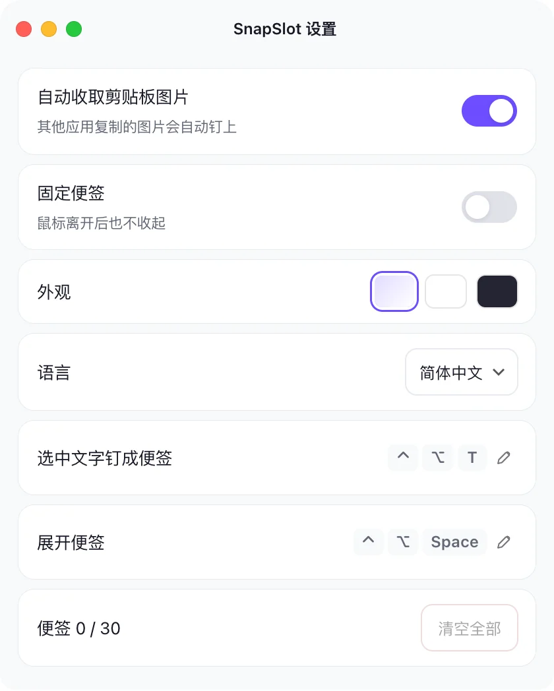

<!-- Generated by scripts/readme-build.py — edit that file, not this one. -->
<p align="center"></p>

<h1 align="center">SnapSlot 快照贴</h1>

<p align="center"><b>把重要的内容，留在眼前。</b><br>把截图和文字贴在屏幕上，让参考资料和临时想法随时可见。</p>

<p align="center">
  <a href="https://github.com/LING-0001/SnapSlot/releases/download/v1.1.2/SnapSlot-1.1.2-macOS-universal.dmg"><b>下载 macOS 版</b></a> ·
  <a href="https://github.com/LING-0001/SnapSlot/releases/download/v1.1.2/SnapSlot-1.1.2-windows-x64-setup.exe"><b>下载 Windows 版</b></a> ·
  <a href="https://snapslot.linglinglab.top/zh-Hans/">在线体验</a>
</p>

<p align="center"><b>简体中文</b> · <a href="docs/readme/README.en.md">English</a> · <a href="docs/readme/README.zh-Hant.md">繁體中文</a> · <a href="docs/readme/README.ja.md">日本語</a> · <a href="docs/readme/README.ko.md">한국어</a> · <a href="docs/readme/README.es.md">Español</a></p>

<p align="center"><a href="https://raw.githubusercontent.com/LING-0001/SnapSlot/b9d562897b3821d4db235fdfa4ca0a49c70d9ba1/docs/media/zh-Hans/demo.mp4"></a></p>
<p align="center"><sub><a href="https://raw.githubusercontent.com/LING-0001/SnapSlot/b9d562897b3821d4db235fdfa4ca0a49c70d9ba1/docs/media/zh-Hans/demo.mp4">观看演示</a> · <a href="https://raw.githubusercontent.com/LING-0001/SnapSlot/b9d562897b3821d4db235fdfa4ca0a49c70d9ba1/docs/media/zh-Hans/demo.gif">查看动图</a> · <a href="https://github.com/LING-0001/SnapSlot/releases/tag/v1.1.2">v1.1.2</a> · <a href="docs/releases/hosting.md">安装说明</a></sub></p>

## 怎么用

1. **移到上沿，停一下**<br>
   鼠标在屏幕最上沿停 0.5 秒，便签以扇形落下；往下移开就收起。滚轮转动扇形。
2. **选中文字，按快捷键**<br>
   选中允许复制的文字，按 `⌃ ⌥ T`（Windows：`Ctrl + Alt + T`），收为文字便签，原文同时复制到剪贴板。
3. **拖出去就能用**<br>
   按住便签拖到支持接收图片或文字的应用，也可以拖到文件夹，作为 PNG / TXT 放下。

## 菜单与设置

点按 macOS 菜单栏图标，或右键 Dock 图标，即可打开设置、切换自动收取和固定便签。Windows 使用托盘右键菜单。设置中可以更换外观、语言与快捷键，也可以清空当前便签。

<p align="center"></p>

## 快捷键

| 操作 | macOS | Windows |
| --- | --- | --- |
| 展开 / 收起便签 | <kbd>⌃</kbd> <kbd>⌥</kbd> <kbd>Space</kbd> | <kbd>Ctrl</kbd> <kbd>Alt</kbd> <kbd>Space</kbd> |
| 收取选中文字 | <kbd>⌃</kbd> <kbd>⌥</kbd> <kbd>T</kbd> | <kbd>Ctrl</kbd> <kbd>Alt</kbd> <kbd>T</kbd> |
| 放大查看便签 | <kbd>Space</kbd> | <kbd>Space</kbd> |
| 挑选 / 复制 / 移除 / 收起 | <kbd>←</kbd> <kbd>→</kbd> / <kbd>Enter</kbd> / <kbd>Delete</kbd> / <kbd>Esc</kbd> | <kbd>←</kbd> <kbd>→</kbd> / <kbd>Enter</kbd> / <kbd>Delete</kbd> / <kbd>Esc</kbd> |

表中为默认快捷键。Mac 和 Windows 均可在设置中点击组合键，再按下新组合。启动和打开设置时会同时检查两组快捷键，提前显示检测到的冲突及可用替代组合。录入不屏蔽其他应用；Mac 录入无需辅助功能权限，收取选中文字时才需要。部分共享注册的快捷键可能无法检测。

## 隐私

自动收取新复制的图片；文字只在你选中并按下快捷键时收取。内容在本机处理，不上传便签。最多 30 张，满额移除最早一张，正常退出后清空当前便签会话。

## 开发与贡献

<details>
<summary>从源码构建 · 仓库结构 · 测试</summary>

### 从源码构建

```bash
# 官网
npm ci --prefix apps/website
npm run dev --prefix apps/website
```

```bash
# macOS（需要 Command Line Tools、Node.js 22+）
./scripts/build-macos.sh
open artifacts/macos/SnapSlot.app
```

```powershell
# Windows（需要 .NET 10 SDK、Node.js 22+）
.\scripts\build-windows.ps1
.\artifacts\windows\win-x64\SnapSlot.exe
```

用户可直接下载上方 DMG / Setup 安装包。源码构建产物供开发调试。Mac 包为 ad-hoc 签名，未做 Apple 公证，系统可能阻止首次启动。发布与服务器部署见 [发布指南](docs/releases/hosting.md)。

### 仓库结构

| | |
| --- | --- |
| `apps/website` | 官网与六语言交互演示 |
| `apps/native-ui` | 两端共用的扇形便签、菜单与设置 |
| `apps/windows` | Windows 客户端（C# / WPF + WebView2） |
| `apps/macos` | macOS 客户端（Swift / AppKit + WKWebView） |
| `docs` | 当前规范、测试清单、README 图片 |

### 测试

构建、自动化测试和实机验收命令见 [CONTRIBUTING.md](CONTRIBUTING.md) 与 `docs/native-testing.md`。

欢迎 Issue 和 PR。围绕一个需求组织提交，写清涉及平台、行为变化与实际验证。详见 [CONTRIBUTING.md](CONTRIBUTING.md)。

</details>

## 许可

代码以 MIT 许可开源。名称与图标不在 MIT 授权范围内，见 [BRANDING.md](BRANDING.md)。

[GitHub Issues](https://github.com/LING-0001/SnapSlot/issues) · [参与贡献](CONTRIBUTING.md) · [e1347605313@gmail.com](mailto:e1347605313@gmail.com)
