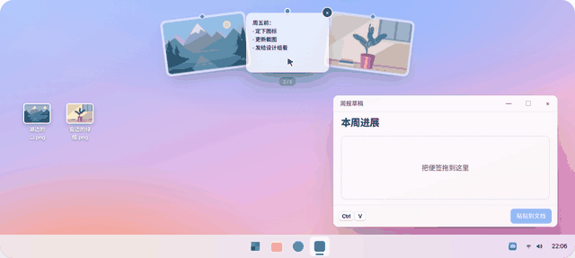
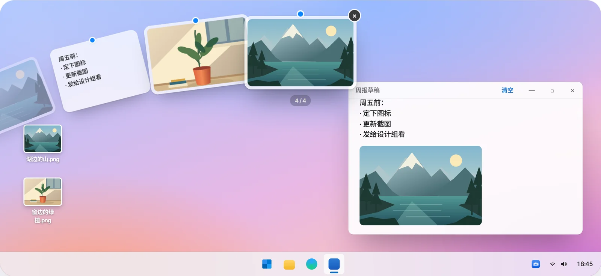
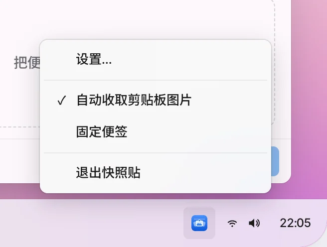
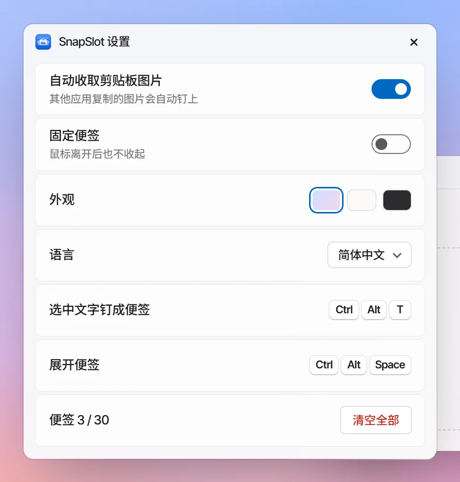
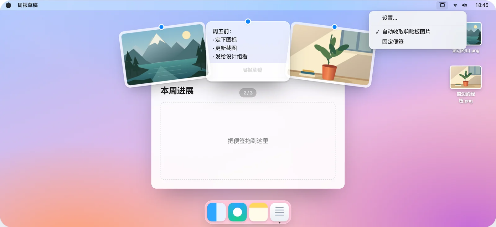

<!-- Generated by scripts/readme-build.py — edit that file, not this one. -->
<p align="center"></p>

<h1 align="center">SnapSlot 快照贴</h1>

<p align="center"><b>复制过的，都钉在屏幕顶上。</b><br>复制的图片、选中的文字，变成屏幕上沿的便签。点一下，就回到剪贴板。</p>

<p align="center">Windows 10 / 11 · macOS 13+ · 免费开源 · 不需要账号 · 不上传</p>

<p align="center">
  <a href="http://101.200.239.135/zh-Hans/"><b>在线体验</b></a> ·
  <a href="http://101.200.239.135/zh-Hans/#downloads">下载</a> ·
  <a href="https://github.com/LING-0001/SnapSlot/releases">GitHub Releases</a> ·
  <a href="CONTRIBUTING.md">参与贡献</a>
</p>

<p align="center"><b>简体中文</b> · <a href="docs/readme/README.en.md">English</a> · <a href="docs/readme/README.zh-Hant.md">繁體中文</a> · <a href="docs/readme/README.ja.md">日本語</a> · <a href="docs/readme/README.ko.md">한국어</a> · <a href="docs/readme/README.es.md">Español</a></p>

<p align="center">v1.1.0 · <a href="http://101.200.239.135/downloads/v1.1.0/SnapSlot-1.1.0-macOS-universal.dmg">macOS · DMG · Apple Silicon / Intel</a> · <a href="http://101.200.239.135/downloads/v1.1.0/SnapSlot-1.1.0-windows-x64-setup.exe">Windows x64 · Setup</a></p>

<p align="center"></p>
<p align="center"><a href="docs/media/zh-Hans/demo.mp4">MP4 · v1.1.0</a></p>

## 怎么用

<table>
<tr><td width="56%"></td><td width="44%"><h3>移到上沿，停一下</h3><p>鼠标在屏幕最上沿停 0.5 秒，便签以扇形落下；往下移开就收起。滚轮转动扇形。</p></td></tr>
<tr><td width="44%"><h3>拖出去就能用</h3><p>按住便签拖进任何应用或文件夹，作为 PNG / TXT 放下。</p></td><td width="56%"></td></tr>
<tr><td width="56%"></td><td width="44%"><h3>选中文字，按快捷键</h3><p>选中一段文字按 <kbd>Ctrl</kbd> <kbd>Alt</kbd> <kbd>T</kbd>（Mac：<kbd>⌃</kbd> <kbd>⌥</kbd> <kbd>T</kbd>），钉成文字便签，原文同时进剪贴板。</p></td></tr>
</table>

## 托盘菜单与设置

<table>
<tr>
<td width="50%"></td>
<td width="50%"></td>
</tr>
</table>

Windows 右键托盘图标，Mac 单击菜单栏图标：**设置…**、**自动收取剪贴板图片**、**固定便签**（后两项可勾选，勾上「固定」后鼠标离开也不收起）。设置里还能换外观、切换语言、看快捷键、清空全部。菜单底部保留“退出快照贴”入口。

## Windows 与 macOS

<table>
<tr>
<td width="72%"></td>
<td width="28%"></td>
</tr>
</table>

两端界面和交互一致，系统能力各自原生实现。手机上也能体验官网演示。

## 快捷键

| 操作 | Windows | macOS |
| --- | --- | --- |
| 展开 / 收起便签 | <kbd>Ctrl</kbd> <kbd>Alt</kbd> <kbd>Space</kbd> | <kbd>⌃</kbd> <kbd>⌥</kbd> <kbd>Space</kbd> |
| 收取选中文字 | <kbd>Ctrl</kbd> <kbd>Alt</kbd> <kbd>T</kbd> | <kbd>⌃</kbd> <kbd>⌥</kbd> <kbd>T</kbd> |
| 挑选 / 复制 / 移除 / 收起 | <kbd>←</kbd> <kbd>→</kbd> / <kbd>Enter</kbd> / <kbd>Delete</kbd> / <kbd>Esc</kbd> | <kbd>←</kbd> <kbd>→</kbd> / <kbd>Enter</kbd> / <kbd>Delete</kbd> / <kbd>Esc</kbd> |

表中为默认快捷键。Mac 和 Windows 均可在设置中点击组合键，再按下新组合。启动和打开设置时会同时检查两组快捷键，提前显示检测到的冲突及可用替代组合。录入不屏蔽其他应用；Mac 录入无需辅助功能权限，收取选中文字时才需要。部分共享注册的快捷键可能无法检测。

## 隐私

只收其他应用写进剪贴板的图片，以及按快捷键时选中的文字。不上传内容；最多 30 张，正常退出后清空。

## 从源码构建

```bash
# 官网
npm ci --prefix apps/website
npm run dev --prefix apps/website -- --port 3000
```

```powershell
# Windows（需要 .NET 10 SDK、Node.js 22+）
.\scripts\build-windows.ps1
.\artifacts\windows\win-x64\SnapSlot.exe
```

```bash
# macOS（需要 Command Line Tools、Node.js 22+）
./scripts/build-macos.sh
open artifacts/macos/SnapSlot.app
```

用户可直接下载上方 DMG / Setup 安装包。源码构建产物供开发调试。Mac 包为 ad-hoc 签名，未做 Apple 公证，系统可能阻止首次启动。发布与服务器部署见 [发布指南](docs/releases/hosting.md)。

## 仓库结构

| | |
| --- | --- |
| `apps/website` | 官网与六语言交互演示 |
| `apps/native-ui` | 两端共用的扇形便签、菜单与设置 |
| `apps/windows` | Windows 客户端（C# / WPF + WebView2） |
| `apps/macos` | macOS 客户端（Swift / AppKit + WKWebView） |
| `docs` | 当前规范、测试清单、README 图片 |

## 测试

构建、自动化测试和实机验收命令见 [CONTRIBUTING.md](CONTRIBUTING.md) 与 `docs/native-testing.md`。

## 参与贡献

欢迎 Issue 和 PR。一个提交只做一件事、一次只改一个平台，写清楚为什么改、改了什么、测试结果。详见 [CONTRIBUTING.md](CONTRIBUTING.md)。

问题与建议：[GitHub Issues](https://github.com/LING-0001/SnapSlot/issues) · e1347605313@gmail.com

## 许可

代码以 MIT 许可开源。名称与图标不在 MIT 授权范围内，见 [BRANDING.md](BRANDING.md)。
