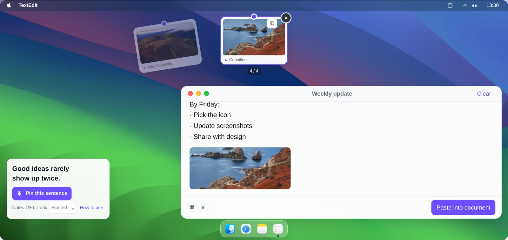
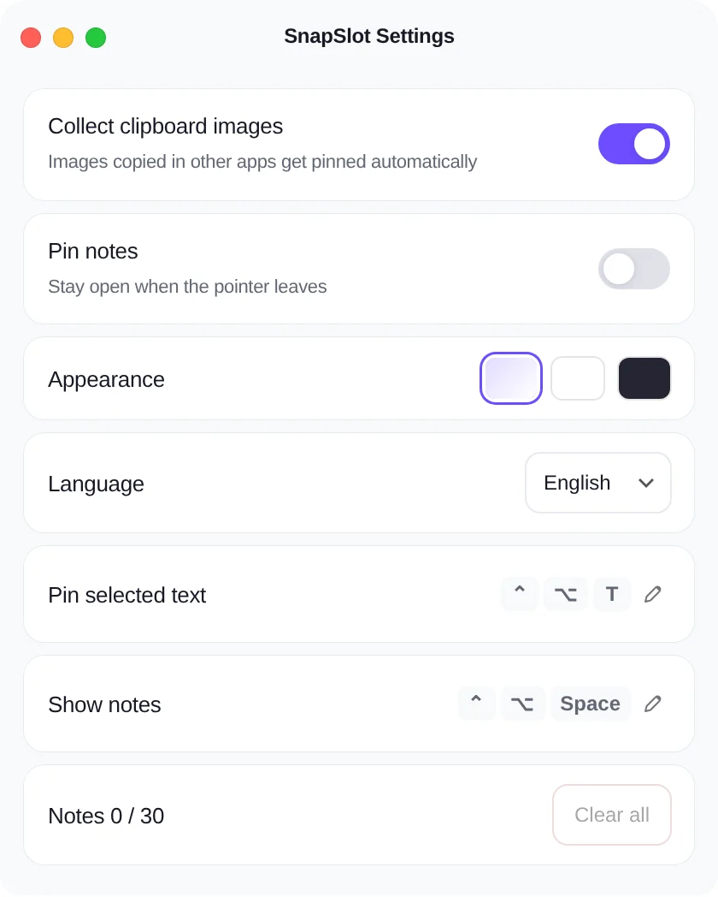

<!-- Generated by scripts/readme-build.py — edit that file, not this one. -->
<p align="center"></p>

<h1 align="center">SnapSlot</h1>

<p align="center"><b>Keep what matters, right in sight.</b><br>Pin screenshots and text above your work. Keep references and passing thoughts within reach.</p>

<p align="center">
  <a href="https://github.com/LING-0001/SnapSlot/releases/download/v1.1.3/SnapSlot-1.1.3-macOS-universal.dmg"><b>Download for macOS</b></a> ·
  <a href="https://github.com/LING-0001/SnapSlot/releases/download/v1.1.3/SnapSlot-1.1.3-windows-x64-setup.exe"><b>Download for Windows</b></a> ·
  <a href="https://snapslot.linglinglab.top/en/">Try it online</a>
</p>

<p align="center"><a href="../../README.md">简体中文</a> · <b>English</b> · <a href="README.zh-Hant.md">繁體中文</a> · <a href="README.ja.md">日本語</a> · <a href="README.ko.md">한국어</a> · <a href="README.es.md">Español</a></p>

<p align="center"><a href="https://raw.githubusercontent.com/LING-0001/SnapSlot/7dedc5051a75da8dd280a618a7ebaa6ba1581a1d/docs/media/en/demo.mp4"></a></p>
<p align="center"><sub><a href="https://raw.githubusercontent.com/LING-0001/SnapSlot/7dedc5051a75da8dd280a618a7ebaa6ba1581a1d/docs/media/en/demo.mp4">Watch the demo</a> · <a href="https://raw.githubusercontent.com/LING-0001/SnapSlot/7dedc5051a75da8dd280a618a7ebaa6ba1581a1d/docs/media/en/demo.gif">View GIF</a> · <a href="https://github.com/LING-0001/SnapSlot/releases/tag/v1.1.3">v1.1.3</a> · <a href="../../docs/releases/hosting.md">Installation guide</a></sub></p>

## How it works

1. **Rest at the top edge**<br>
   Pause the pointer at the very top for half a second and the notes fan down. Move away and they leave. Scroll to turn the fan.
2. **Select text, press the shortcut**<br>
   Select text that the app allows you to copy, then press `⌃ ⌥ T` (Windows: `Ctrl + Alt + T`). It becomes a note, and the full text is copied too.
3. **Drag it where you need it**<br>
   Drop a note into a compatible app or folder as a PNG or TXT file.

## Menu and settings

Click the macOS menu-bar icon or right-click the Dock icon to open Settings, toggle image collection, or pin notes. On Windows, use the tray menu. Settings also controls appearance, language, shortcuts, and clearing the current notes.

<p align="center"></p>

## Shortcuts

| Action | macOS | Windows |
| --- | --- | --- |
| Show / hide notes | <kbd>⌃</kbd> <kbd>⌥</kbd> <kbd>Space</kbd> | <kbd>Ctrl</kbd> <kbd>Alt</kbd> <kbd>Space</kbd> |
| Pin selected text | <kbd>⌃</kbd> <kbd>⌥</kbd> <kbd>T</kbd> | <kbd>Ctrl</kbd> <kbd>Alt</kbd> <kbd>T</kbd> |
| Read a full note | <kbd>Space</kbd> | <kbd>Space</kbd> |
| Choose / copy / remove / hide | <kbd>←</kbd> <kbd>→</kbd> / <kbd>Enter</kbd> / <kbd>Delete</kbd> / <kbd>Esc</kbd> | <kbd>←</kbd> <kbd>→</kbd> / <kbd>Enter</kbd> / <kbd>Delete</kbd> / <kbd>Esc</kbd> |

These are the defaults. Click a shortcut in Settings and press a new combination. Both bindings are checked at startup and when Settings opens, showing detected conflicts and available replacements before editing. Recording leaves other apps active and needs no Accessibility permission on Mac; collecting selected text does. Some shared shortcut registrations may not be detectable.

## Privacy

Newly copied images are collected automatically. Text is collected only after you select it and press the shortcut. Notes are processed locally and are not uploaded. Keep up to 30 notes; the oldest is removed when full, and a normal exit clears the current note session.

## Development & contributing

<details>
<summary>Build from source · Repository layout · Tests</summary>

### Build from source

```bash
# Website
npm ci --prefix apps/website
npm run dev --prefix apps/website
```

```bash
# macOS (Command Line Tools, Node.js 22+)
./scripts/build-macos.sh
open artifacts/macos/SnapSlot.app
```

```powershell
# Windows (.NET 10 SDK, Node.js 22+)
.\scripts\build-windows.ps1
.\artifacts\windows\win-x64\SnapSlot.exe
```

Download the DMG / Setup installer above. The release Mac package is Developer ID signed and notarized by Apple; macOS may still ask you to confirm the first launch. Source builds use ad-hoc signatures for development. See the [release and hosting guide](../../docs/releases/hosting.md).

### Repository layout

| | |
| --- | --- |
| `apps/website` | Website and interactive demo in six languages |
| `apps/native-ui` | Fan notes, menu and settings shared by both clients |
| `apps/windows` | Windows client (C# / WPF + WebView2) |
| `apps/macos` | macOS client (Swift / AppKit + WKWebView) |
| `docs` | Current specifications, test checklists, README images |

### Tests

Build, automated test and physical-machine acceptance commands are in [CONTRIBUTING.md](../../CONTRIBUTING.md) and `docs/native-testing.md`.

Issues and PRs welcome. Keep commits focused on one need and describe the affected platforms, behavior changes, and actual verification. See [CONTRIBUTING.md](../../CONTRIBUTING.md) (Chinese).

</details>

## License

Code is MIT licensed. The name and icon are not covered by the MIT license; see [BRANDING.md](../../BRANDING.md).

[GitHub Issues](https://github.com/LING-0001/SnapSlot/issues) · [Contribute](../../CONTRIBUTING.md) · [e1347605313@gmail.com](mailto:e1347605313@gmail.com)
