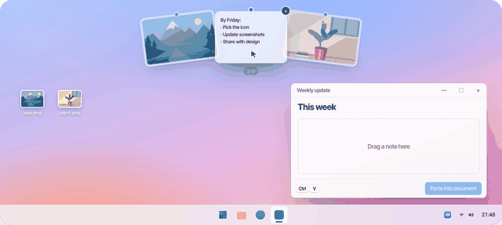
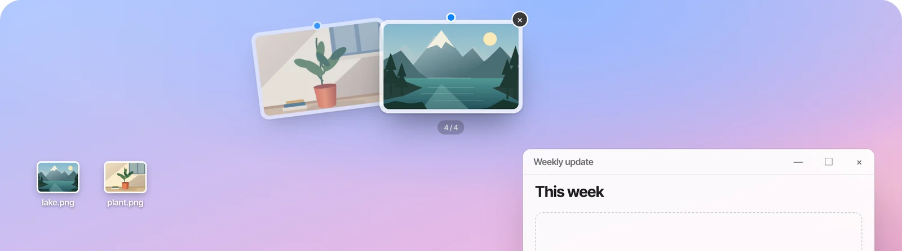
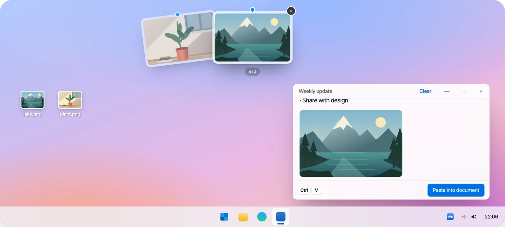
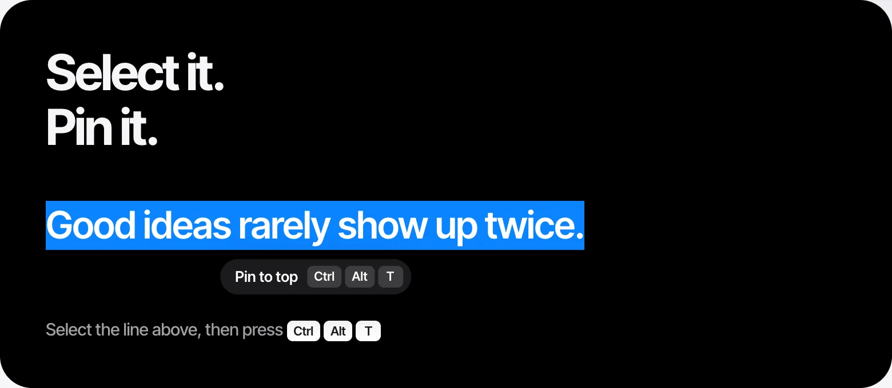
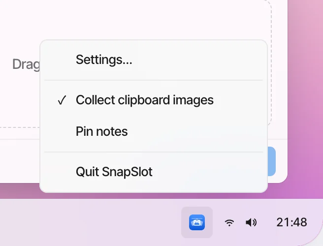
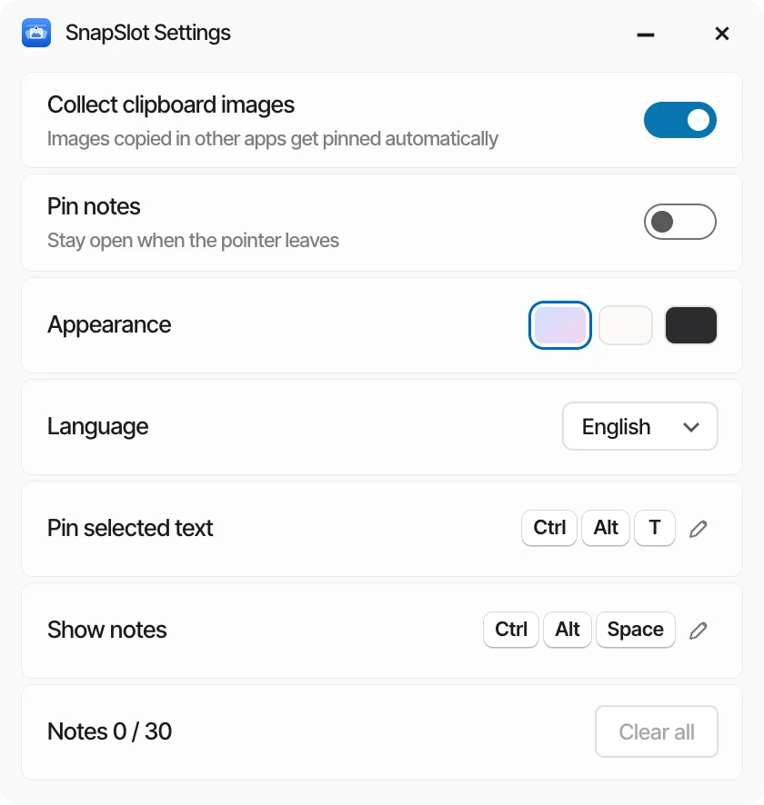
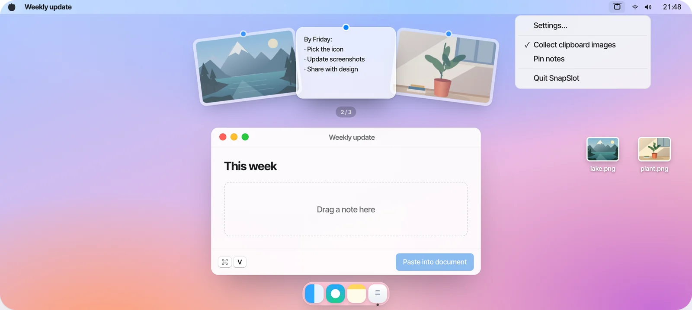
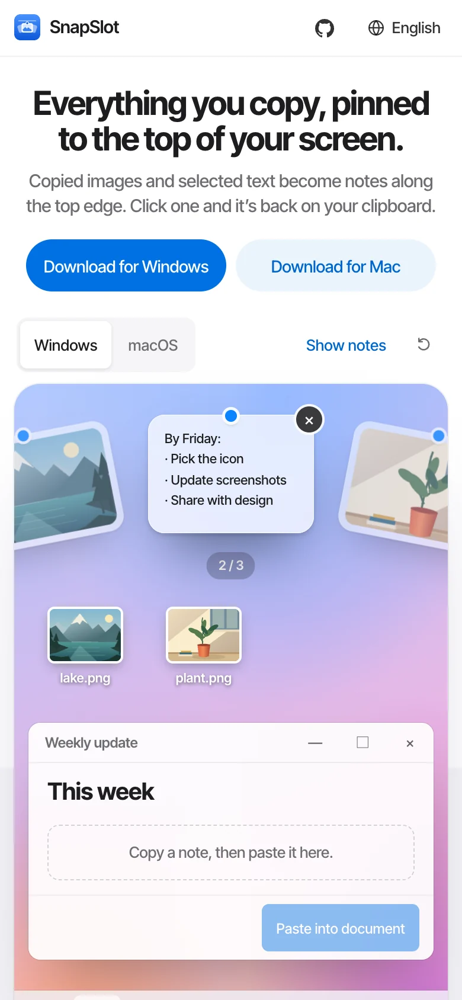

<!-- Generated by scripts/readme-build.py — edit that file, not this one. -->
<p align="center"></p>

<h1 align="center">SnapSlot</h1>

<p align="center"><b>Everything you copy, pinned to the top of your screen.</b><br>Copied images and selected text become notes along the top edge. Click one and it’s back on your clipboard.</p>

<p align="center">Windows 10 / 11 · macOS 13+ · Free and open source · No account · No uploads</p>

<p align="center">
  <a href="http://101.200.239.135/en/"><b>Try it online</b></a> ·
  <a href="https://github.com/LING-0001/SnapSlot/releases">Download</a> ·
  <a href="../../CONTRIBUTING.md">Contribute</a>
</p>

<p align="center"><a href="../../README.md">简体中文</a> · <b>English</b> · <a href="README.zh-Hant.md">繁體中文</a> · <a href="README.ja.md">日本語</a> · <a href="README.ko.md">한국어</a> · <a href="README.es.md">Español</a></p>

<p align="center"></p>

## How it works

<table>
<tr><td width="56%"></td><td width="44%"><h3>Rest at the top edge</h3><p>Pause the pointer at the very top for half a second and the notes fan down. Move away and they leave. Scroll to turn the fan.</p></td></tr>
<tr><td width="44%"><h3>Drag it where you need it</h3><p>Hold a note and drop it into any app or folder as a PNG or TXT file.</p></td><td width="56%"></td></tr>
<tr><td width="56%"></td><td width="44%"><h3>Select text, press the shortcut</h3><p>Select some text and press <kbd>Ctrl</kbd> <kbd>Alt</kbd> <kbd>T</kbd> (Mac: <kbd>⌃</kbd> <kbd>⌥</kbd> <kbd>T</kbd>). It becomes a note, and the full text is copied too.</p></td></tr>
</table>

## Tray menu and settings

<table>
<tr>
<td width="50%"></td>
<td width="50%"></td>
</tr>
</table>

Right-click the tray icon on Windows, or click the menu-bar icon on Mac: **Settings…**, **Collect clipboard images**, **Pin notes** (both checkable; with Pin on, notes stay open when the pointer leaves). Settings also change the look and language, show shortcuts, and clear everything.

## Windows and macOS

<table>
<tr>
<td width="72%"></td>
<td width="28%"></td>
</tr>
</table>

Same notes and gestures on both; each uses its own system features natively. The website demo works on phones too.

## Shortcuts

| Action | Windows | macOS |
| --- | --- | --- |
| Show / hide notes | <kbd>Ctrl</kbd> <kbd>Alt</kbd> <kbd>Space</kbd> | <kbd>⌃</kbd> <kbd>⌥</kbd> <kbd>Space</kbd> |
| Pin selected text | <kbd>Ctrl</kbd> <kbd>Alt</kbd> <kbd>T</kbd> | <kbd>⌃</kbd> <kbd>⌥</kbd> <kbd>T</kbd> |
| Screenshot | <kbd>Ctrl</kbd> <kbd>Shift</kbd> <kbd>S</kbd> | <kbd>⌃</kbd> <kbd>⌥</kbd> <kbd>S</kbd> |
| Choose / copy / remove / hide | <kbd>←</kbd> <kbd>→</kbd> / <kbd>Enter</kbd> / <kbd>Delete</kbd> / <kbd>Esc</kbd> | <kbd>←</kbd> <kbd>→</kbd> / <kbd>Enter</kbd> / <kbd>Delete</kbd> / <kbd>Esc</kbd> |

All shortcuts can be re-recorded in Settings.

## Privacy

No screenshots taken for you, no file access, no network. SnapSlot only takes images other apps put on the clipboard, and text you select when you press the shortcut. Up to 30 notes; quit and they’re gone.

## Build from source

```bash
# Website
npm ci --prefix apps/website
npm run dev --prefix apps/website -- --port 3000
```

```powershell
# Windows (.NET 10 SDK, Node.js 22+)
.\scripts\build-windows.ps1
.\artifacts\windows\win-x64\SnapSlot.exe
```

```bash
# macOS (Command Line Tools, Node.js 22+)
./scripts/build-macos.sh
open artifacts/macos/SnapSlot.app
```

On Windows, keep the whole `artifacts/windows/win-x64/` folder or ZIP together; the exe alone won’t run. The local Mac build is ad-hoc signed, for testing only.

## Repository layout

| | |
| --- | --- |
| `apps/website` | Website (six languages), skin parser |
| `apps/native-ui` | Note and appearance panels shared by both clients |
| `apps/windows` | Windows client (C# / WPF + WebView2) |
| `apps/macos` | macOS client (Swift / AppKit + WKWebView) |
| `docs` | Design records, test checklists, README images |

## Tests

Website and shared UI: 24 / 24 passing. Windows / macOS checks and the hardware checklist are in [CONTRIBUTING.md](../../CONTRIBUTING.md) and `docs/native-testing.md`.

## Contributing

Issues and PRs welcome. One change per commit, one platform per commit, and say why, what changed, and what the tests showed. See [CONTRIBUTING.md](../../CONTRIBUTING.md) (Chinese).

Questions and ideas：[GitHub Issues](https://github.com/LING-0001/SnapSlot/issues) · e1347605313@gmail.com

## License

Code is MIT licensed. The name and icon are not covered by the MIT license; see [BRANDING.md](../../BRANDING.md).
