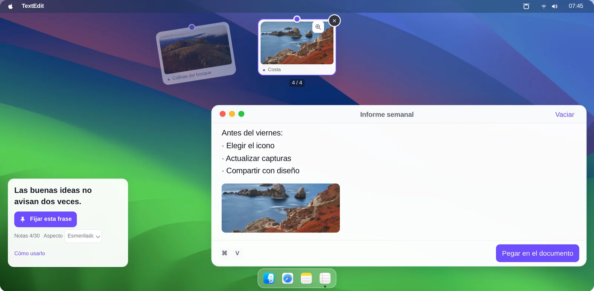
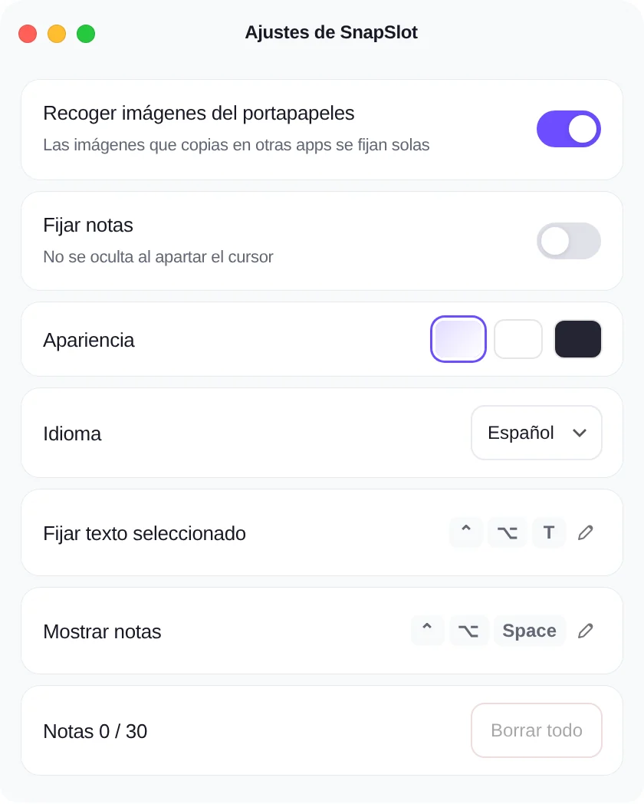

<!-- Generated by scripts/readme-build.py — edit that file, not this one. -->
<p align="center"></p>

<h1 align="center">SnapSlot</h1>

<p align="center"><b>Capturas y texto, siempre a la vista.</b><br>Fija capturas y notas sobre tu trabajo. Referencias e ideas, siempre cerca.</p>

<p align="center">
  <a href="https://github.com/LING-0001/SnapSlot/releases/download/v1.1.2/SnapSlot-1.1.2-macOS-universal.dmg"><b>Descargar para macOS</b></a> ·
  <a href="https://github.com/LING-0001/SnapSlot/releases/download/v1.1.2/SnapSlot-1.1.2-windows-x64-setup.exe"><b>Descargar para Windows</b></a> ·
  <a href="https://snapslot.linglinglab.top/es/">Pruébalo en línea</a>
</p>

<p align="center"><a href="../../README.md">简体中文</a> · <a href="README.en.md">English</a> · <a href="README.zh-Hant.md">繁體中文</a> · <a href="README.ja.md">日本語</a> · <a href="README.ko.md">한국어</a> · <b>Español</b></p>

<p align="center"><a href="https://raw.githubusercontent.com/LING-0001/SnapSlot/b9d562897b3821d4db235fdfa4ca0a49c70d9ba1/docs/media/es/demo.mp4"></a></p>
<p align="center"><sub><a href="https://raw.githubusercontent.com/LING-0001/SnapSlot/b9d562897b3821d4db235fdfa4ca0a49c70d9ba1/docs/media/es/demo.mp4">Ver la demostración</a> · <a href="https://raw.githubusercontent.com/LING-0001/SnapSlot/b9d562897b3821d4db235fdfa4ca0a49c70d9ba1/docs/media/es/demo.gif">Ver GIF</a> · <a href="https://github.com/LING-0001/SnapSlot/releases/tag/v1.1.2">v1.1.2</a> · <a href="../../docs/releases/hosting.md">Guía de instalación</a></sub></p>

## Cómo funciona

1. **Detente en el borde superior**<br>
   Deja el cursor arriba del todo medio segundo y las notas bajan en abanico. Al apartarlo, se van. La rueda gira el abanico.
2. **Selecciona texto y pulsa el atajo**<br>
   Selecciona texto que la aplicación permita copiar y pulsa `⌃ ⌥ T` (Windows: `Ctrl + Alt + T`). Se crea una nota y el texto completo se copia al portapapeles.
3. **Arrástrala donde la necesites**<br>
   Suelta una nota en una aplicación compatible o una carpeta como archivo PNG o TXT.

## Menú y ajustes

Haz clic en el icono de la barra de menús de macOS o clic derecho en el icono del Dock para abrir Ajustes, activar la captura de imágenes o fijar notas. En Windows, usa el menú de la bandeja. Ajustes permite cambiar el aspecto, el idioma, los atajos y borrar las notas actuales.

<p align="center"></p>

## Atajos

| Acción | macOS | Windows |
| --- | --- | --- |
| Mostrar / ocultar notas | <kbd>⌃</kbd> <kbd>⌥</kbd> <kbd>Space</kbd> | <kbd>Ctrl</kbd> <kbd>Alt</kbd> <kbd>Space</kbd> |
| Fijar texto seleccionado | <kbd>⌃</kbd> <kbd>⌥</kbd> <kbd>T</kbd> | <kbd>Ctrl</kbd> <kbd>Alt</kbd> <kbd>T</kbd> |
| Ampliar una nota | <kbd>Space</kbd> | <kbd>Space</kbd> |
| Elegir / copiar / quitar / ocultar | <kbd>←</kbd> <kbd>→</kbd> / <kbd>Enter</kbd> / <kbd>Delete</kbd> / <kbd>Esc</kbd> | <kbd>←</kbd> <kbd>→</kbd> / <kbd>Enter</kbd> / <kbd>Delete</kbd> / <kbd>Esc</kbd> |

Estos son los atajos predeterminados. Haz clic en uno en Ajustes y pulsa una nueva combinación. Ambos se comprueban al iniciar y al abrir Ajustes, mostrando los conflictos detectados y las alternativas antes de editar. La grabación permite que otras apps sigan respondiendo. En Mac, Accesibilidad solo se necesita para recoger texto seleccionado. Algunos registros compartidos pueden no detectarse.

## Privacidad

Recoge automáticamente las imágenes recién copiadas. El texto solo se recoge cuando lo seleccionas y pulsas el atajo. Las notas se procesan localmente y no se suben. Conserva hasta 30 notas; al llenarse se elimina la más antigua y, al cerrar normalmente, se borra la sesión actual.

## Desarrollo y contribuciones

<details>
<summary>Compilar desde el código · Estructura del repositorio · Pruebas</summary>

### Compilar desde el código

```bash
# Sitio web
npm ci --prefix apps/website
npm run dev --prefix apps/website
```

```bash
# macOS (Command Line Tools, Node.js 22+)
./scripts/build-macos.sh
open artifacts/macos/SnapSlot.app
```

```powershell
# Windows (.NET 10 SDK, Node.js 22+)
.\scripts\build-windows.ps1
.\artifacts\windows\win-x64\SnapSlot.exe
```

Descarga el instalador DMG / Setup de arriba para instalar la aplicación. Los resultados de compilar el código son para desarrollo. El paquete de Mac tiene firma ad-hoc y no está notarizado por Apple; el sistema puede bloquear el primer inicio. Consulta la [guía de publicación y alojamiento](../../docs/releases/hosting.md).

### Estructura del repositorio

| | |
| --- | --- |
| `apps/website` | Sitio y demostración interactiva en seis idiomas |
| `apps/native-ui` | Notas en abanico, menú y ajustes compartidos |
| `apps/windows` | Cliente de Windows (C# / WPF + WebView2) |
| `apps/macos` | Cliente de macOS (Swift / AppKit + WKWebView) |
| `docs` | Especificaciones actuales, listas de pruebas, imágenes del README |

### Pruebas

Los comandos de compilación, pruebas automáticas y aceptación en equipos reales están en [CONTRIBUTING.md](../../CONTRIBUTING.md) y `docs/native-testing.md`.

Se agradecen Issues y PR. Agrupa los commits por una necesidad e indica las plataformas afectadas, los cambios de comportamiento y la verificación realizada. Consulta [CONTRIBUTING.md](../../CONTRIBUTING.md) (en chino).

</details>

## Licencia

El código tiene licencia MIT. El nombre y el icono no están cubiertos por la MIT; consulta [BRANDING.md](../../BRANDING.md).

[GitHub Issues](https://github.com/LING-0001/SnapSlot/issues) · [Contribuir](../../CONTRIBUTING.md) · [e1347605313@gmail.com](mailto:e1347605313@gmail.com)
