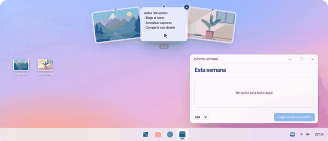
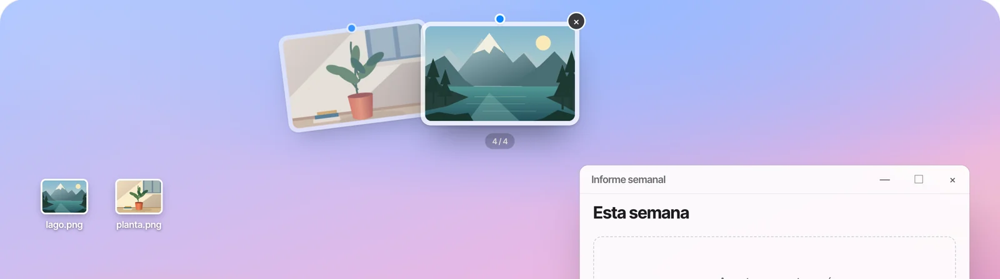
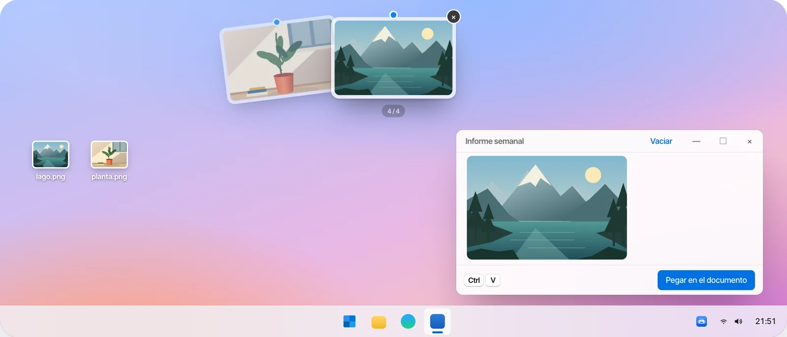
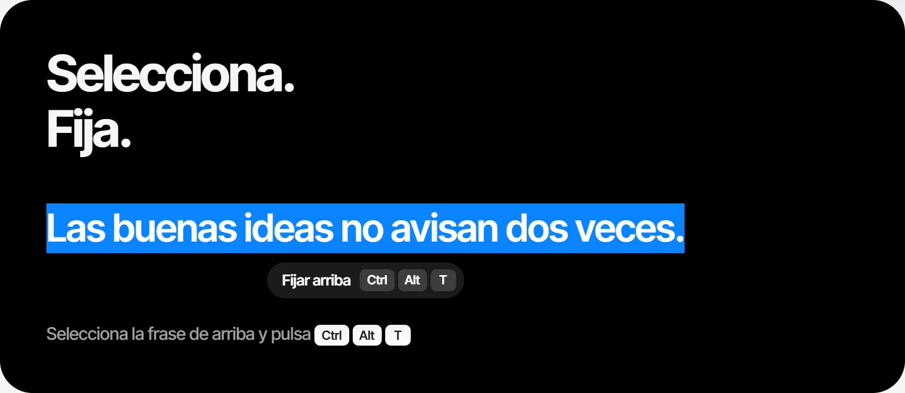
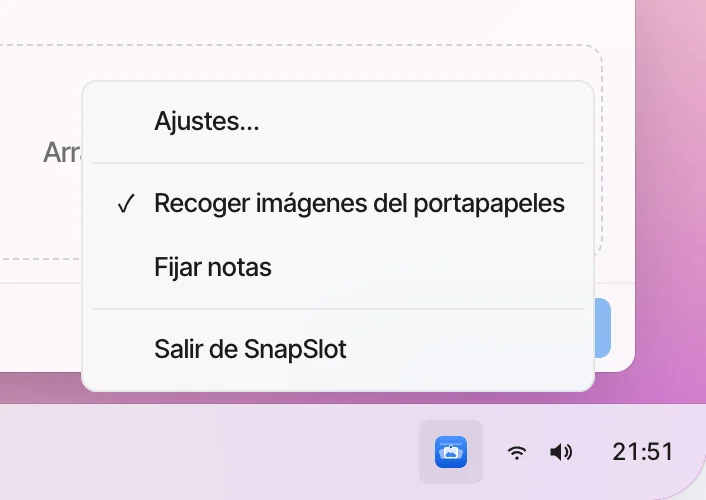
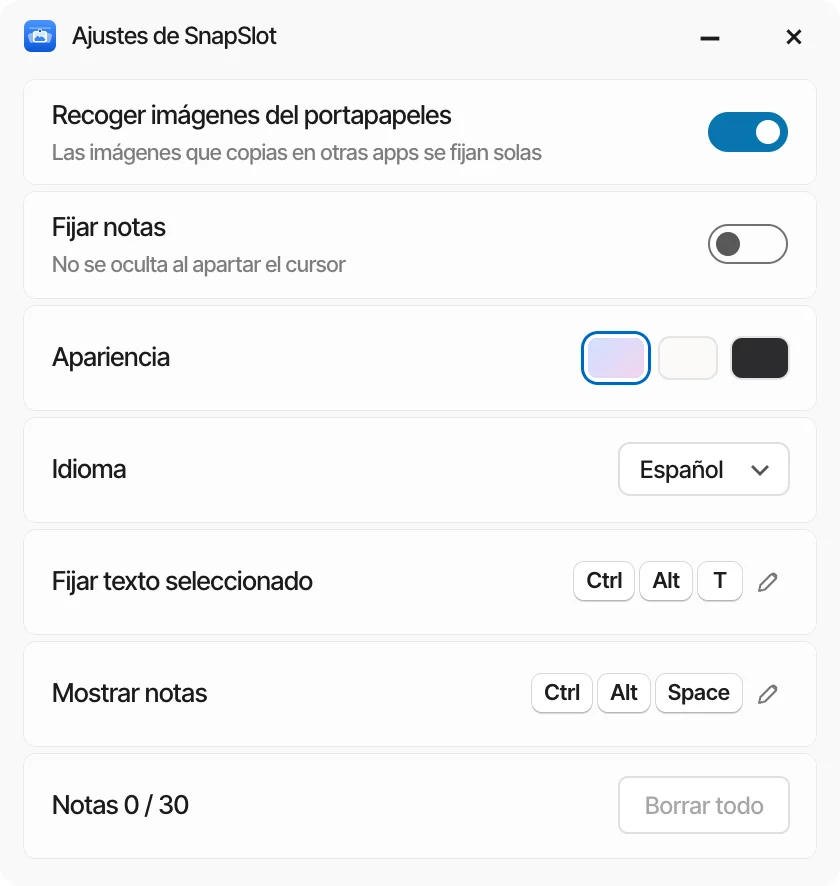
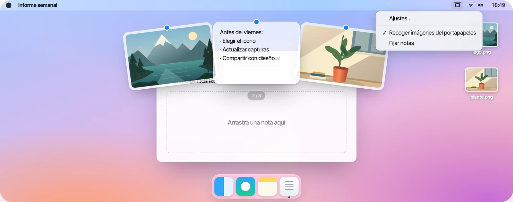
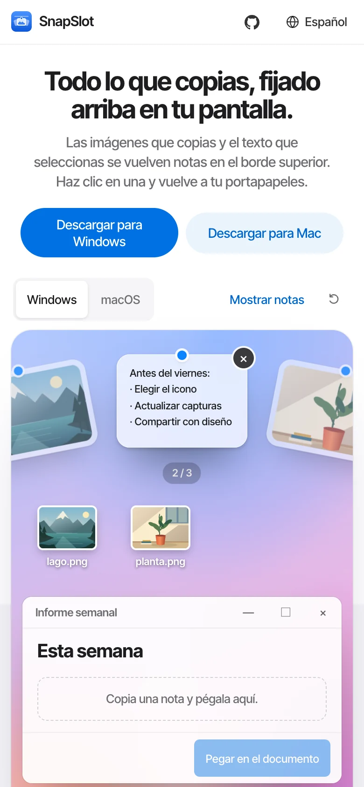

<!-- Generated by scripts/readme-build.py — edit that file, not this one. -->
<p align="center"></p>

<h1 align="center">SnapSlot</h1>

<p align="center"><b>Todo lo que copias, fijado arriba en tu pantalla.</b><br>Las imágenes que copias y el texto que seleccionas se vuelven notas en el borde superior. Haz clic en una y vuelve a tu portapapeles.</p>

<p align="center">Windows 10 / 11 · macOS 13+ · Gratis y de código abierto · Sin cuenta · Sin subidas</p>

<p align="center">
  <a href="http://101.200.239.135/es/"><b>Pruébalo en línea</b></a> ·
  <a href="http://101.200.239.135/es/#downloads">Descargar</a> ·
  <a href="https://github.com/LING-0001/SnapSlot/releases">GitHub Releases</a> ·
  <a href="../../CONTRIBUTING.md">Contribuir</a>
</p>

<p align="center"><a href="../../README.md">简体中文</a> · <a href="README.en.md">English</a> · <a href="README.zh-Hant.md">繁體中文</a> · <a href="README.ja.md">日本語</a> · <a href="README.ko.md">한국어</a> · <b>Español</b></p>

<p align="center">v1.0.0 · <a href="http://101.200.239.135/downloads/v1.0.0/SnapSlot-1.0.0-macOS-universal.dmg">macOS · DMG · Apple Silicon / Intel</a> · <a href="http://101.200.239.135/downloads/v1.0.0/SnapSlot-1.0.0-windows-x64-setup.exe">Windows x64 · Setup</a></p>

<p align="center"></p>

## Cómo funciona

<table>
<tr><td width="56%"></td><td width="44%"><h3>Detente en el borde superior</h3><p>Deja el cursor arriba del todo medio segundo y las notas bajan en abanico. Al apartarlo, se van. La rueda gira el abanico.</p></td></tr>
<tr><td width="44%"><h3>Arrástrala donde la necesites</h3><p>Mantén pulsada una nota y suéltala en cualquier app o carpeta como archivo PNG o TXT.</p></td><td width="56%"></td></tr>
<tr><td width="56%"></td><td width="44%"><h3>Selecciona texto y pulsa el atajo</h3><p>Selecciona un texto y pulsa <kbd>Ctrl</kbd> <kbd>Alt</kbd> <kbd>T</kbd> (Mac: <kbd>⌃</kbd> <kbd>⌥</kbd> <kbd>T</kbd>). Se vuelve una nota y el texto completo también se copia.</p></td></tr>
</table>

## Menú de la bandeja y ajustes

<table>
<tr>
<td width="50%"></td>
<td width="50%"></td>
</tr>
</table>

Clic derecho en el icono de la bandeja en Windows, o clic en el icono de la barra de menús en Mac: **Ajustes…**, **Recoger imágenes del portapapeles**, **Fijar notas** (las dos últimas se activan y desactivan; con «Fijar», las notas no se ocultan al apartar el cursor). En Ajustes también cambias el aspecto y el idioma, ves los atajos y borras todo. Puedes salir de SnapSlot desde la última opción del menú.

## Windows y macOS

<table>
<tr>
<td width="72%"></td>
<td width="28%"></td>
</tr>
</table>

Las mismas notas y gestos en ambos; cada uno usa las funciones de su sistema de forma nativa. La demostración web también funciona en el móvil.

## Atajos

| Acción | Windows | macOS |
| --- | --- | --- |
| Mostrar / ocultar notas | <kbd>Ctrl</kbd> <kbd>Alt</kbd> <kbd>Space</kbd> | <kbd>⌃</kbd> <kbd>⌥</kbd> <kbd>Space</kbd> |
| Fijar texto seleccionado | <kbd>Ctrl</kbd> <kbd>Alt</kbd> <kbd>T</kbd> | <kbd>⌃</kbd> <kbd>⌥</kbd> <kbd>T</kbd> |
| Elegir / copiar / quitar / ocultar | <kbd>←</kbd> <kbd>→</kbd> / <kbd>Enter</kbd> / <kbd>Delete</kbd> / <kbd>Esc</kbd> | <kbd>←</kbd> <kbd>→</kbd> / <kbd>Enter</kbd> / <kbd>Delete</kbd> / <kbd>Esc</kbd> |

Ajustes muestra los atajos actuales.

## Privacidad

Recoge imágenes que otras apps ponen en el portapapeles y el texto seleccionado al pulsar el atajo. No sube contenido. Hasta 30 notas; al salir normalmente se borra la sesión.

## Compilar desde el código

```bash
# Sitio web
npm ci --prefix apps/website
npm run dev --prefix apps/website -- --port 3000
```

```powershell
# Windows (.NET 10 SDK, Node.js 22+)
.\scripts\build-windows.ps1
.\artifacts\windows\win-x64\SnapSlot.exe
```

```bash
# macOS (Command Line Tools, Node.js 22+)
./scripts/build-macos.sh
open artifacts/macos/SnapSlot.app
```

Descarga el instalador DMG / Setup de arriba para instalar la aplicación. Los resultados de compilar el código son para desarrollo. El paquete de Mac tiene firma ad-hoc y no está notarizado por Apple; el sistema puede bloquear el primer inicio. Consulta la [guía de publicación y alojamiento](../../docs/releases/hosting.md).

## Estructura del repositorio

| | |
| --- | --- |
| `apps/website` | Sitio y demostración interactiva en seis idiomas |
| `apps/native-ui` | Notas en abanico, menú y ajustes compartidos |
| `apps/windows` | Cliente de Windows (C# / WPF + WebView2) |
| `apps/macos` | Cliente de macOS (Swift / AppKit + WKWebView) |
| `docs` | Especificaciones actuales, listas de pruebas, imágenes del README |

## Pruebas

Los comandos de compilación, pruebas automáticas y aceptación en equipos reales están en [CONTRIBUTING.md](../../CONTRIBUTING.md) y `docs/native-testing.md`.

## Contribuir

Se agradecen Issues y PR. Un cambio por commit y una plataforma por commit; explica el porqué, qué cambió y qué mostraron las pruebas. Consulta [CONTRIBUTING.md](../../CONTRIBUTING.md) (en chino).

Preguntas e ideas：[GitHub Issues](https://github.com/LING-0001/SnapSlot/issues) · e1347605313@gmail.com

## Licencia

El código tiene licencia MIT. El nombre y el icono no están cubiertos por la MIT; consulta [BRANDING.md](../../BRANDING.md).
