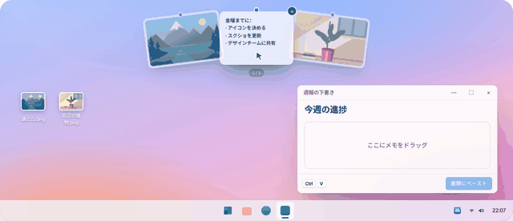
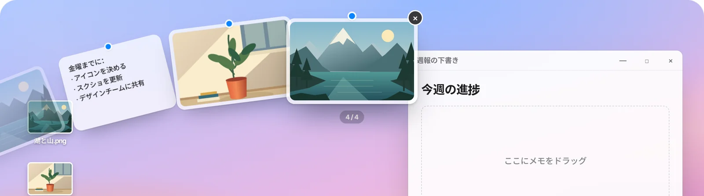
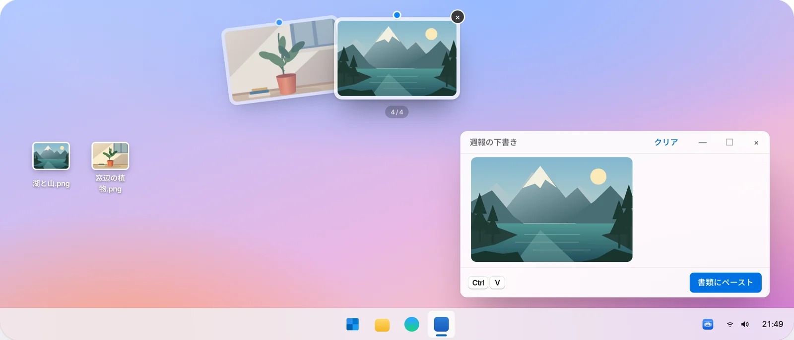
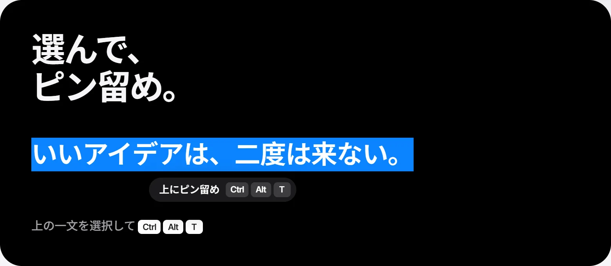
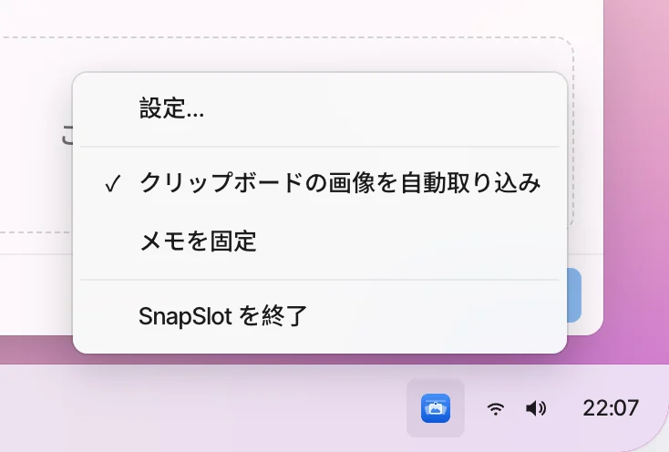
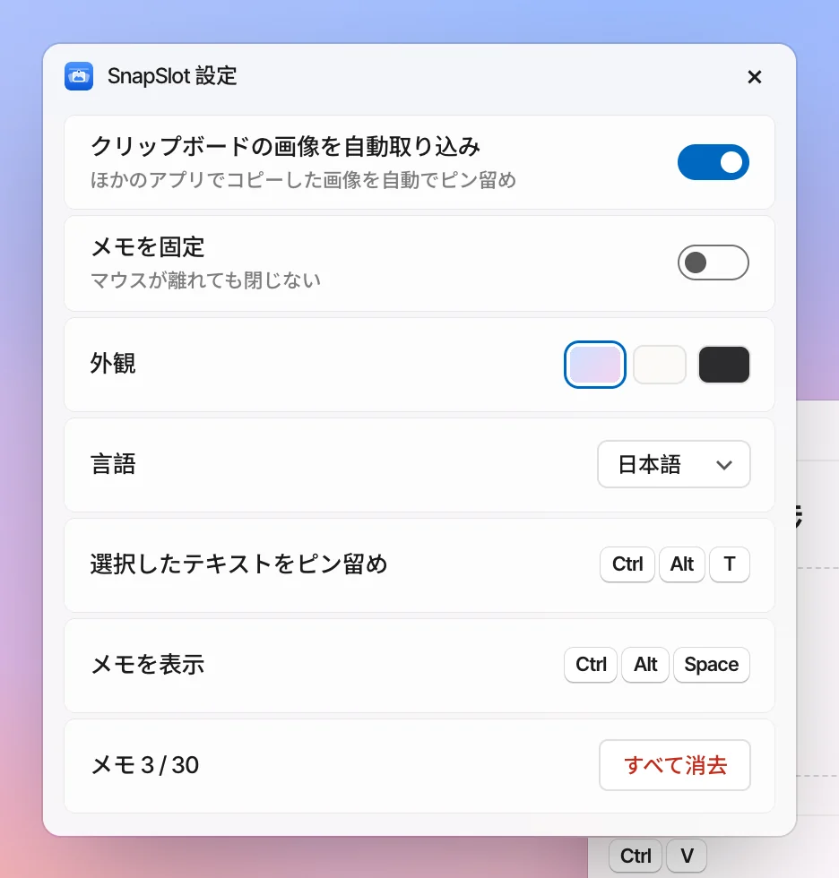
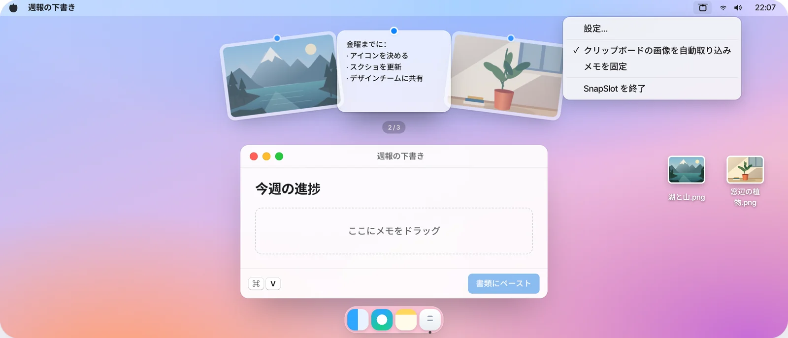
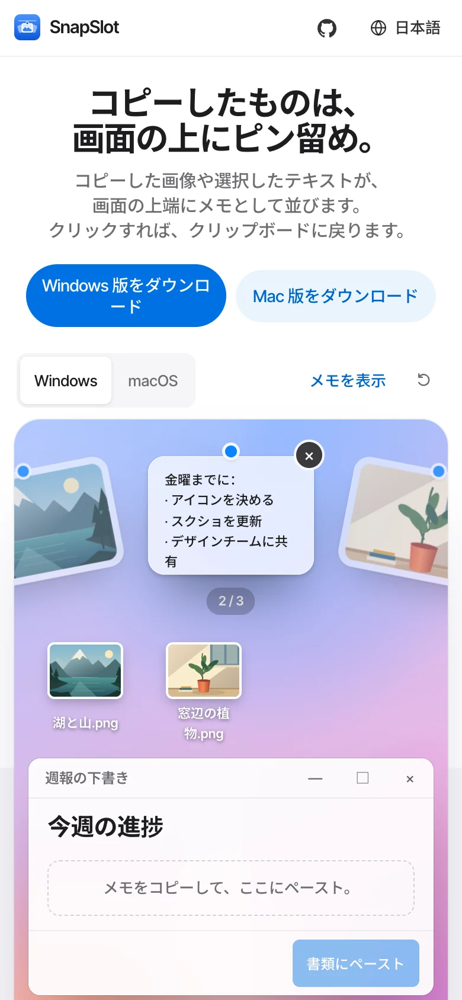

<!-- Generated by scripts/readme-build.py — edit that file, not this one. -->
<p align="center"></p>

<h1 align="center">SnapSlot</h1>

<p align="center"><b>コピーしたものは、画面の上にピン留め。</b><br>コピーした画像や選択したテキストが、画面の上端にメモとして並びます。クリックすれば、クリップボードに戻ります。</p>

<p align="center">Windows 10 / 11 · macOS 13+ · 無料・オープンソース · アカウント不要 · アップロードなし</p>

<p align="center">
  <a href="http://101.200.239.135/ja/"><b>オンラインで試す</b></a> ·
  <a href="http://101.200.239.135/ja/#downloads">ダウンロード</a> ·
  <a href="https://github.com/LING-0001/SnapSlot/releases">GitHub Releases</a> ·
  <a href="../../CONTRIBUTING.md">コントリビュート</a>
</p>

<p align="center"><a href="../../README.md">简体中文</a> · <a href="README.en.md">English</a> · <a href="README.zh-Hant.md">繁體中文</a> · <b>日本語</b> · <a href="README.ko.md">한국어</a> · <a href="README.es.md">Español</a></p>

<p align="center">v1.1.0 · <a href="http://101.200.239.135/downloads/v1.1.0/SnapSlot-1.1.0-macOS-universal.dmg">macOS · DMG · Apple Silicon / Intel</a> · <a href="http://101.200.239.135/downloads/v1.1.0/SnapSlot-1.1.0-windows-x64-setup.exe">Windows x64 · Setup</a></p>

<p align="center"></p>
<p align="center"><a href="../../docs/media/ja/demo.mp4">MP4 · v1.1.0</a></p>

## 使いかた

<table>
<tr><td width="56%"></td><td width="44%"><h3>上端で、少し止まる</h3><p>画面のいちばん上で 0.5 秒止まると、メモが扇形に下りてきます。マウスを下ろすと閉じます。ホイールで扇を回せます。</p></td></tr>
<tr><td width="44%"><h3>ドラッグして使う</h3><p>メモを押さえたまま、アプリやフォルダへ PNG / TXT としてドロップできます。</p></td><td width="56%"></td></tr>
<tr><td width="56%"></td><td width="44%"><h3>テキストを選んでショートカット</h3><p>テキストを選択して <kbd>Ctrl</kbd> <kbd>Alt</kbd> <kbd>T</kbd>（Mac は <kbd>⌃</kbd> <kbd>⌥</kbd> <kbd>T</kbd>）。テキストのメモになり、全文もコピーされます。</p></td></tr>
</table>

## トレイメニューと設定

<table>
<tr>
<td width="50%"></td>
<td width="50%"></td>
</tr>
</table>

Windows はトレイアイコンを右クリック、Mac はメニューバーのアイコンをクリック：**設定…**、**クリップボードの画像を自動取り込み**、**メモを固定**（後の 2 つはオン／オフ。固定するとマウスが離れても閉じません）。設定では見た目・言語の変更、ショートカットの確認、すべて消去もできます。メニューの下部から SnapSlot を終了できます。

## Windows と macOS

<table>
<tr>
<td width="72%"></td>
<td width="28%"></td>
</tr>
</table>

メモと操作は共通、システム機能はそれぞれネイティブで実装しています。サイトのデモはスマホでも動きます。

## ショートカット

| 操作 | Windows | macOS |
| --- | --- | --- |
| メモを表示 / 隠す | <kbd>Ctrl</kbd> <kbd>Alt</kbd> <kbd>Space</kbd> | <kbd>⌃</kbd> <kbd>⌥</kbd> <kbd>Space</kbd> |
| 選択テキストをピン留め | <kbd>Ctrl</kbd> <kbd>Alt</kbd> <kbd>T</kbd> | <kbd>⌃</kbd> <kbd>⌥</kbd> <kbd>T</kbd> |
| 選ぶ / コピー / 削除 / 閉じる | <kbd>←</kbd> <kbd>→</kbd> / <kbd>Enter</kbd> / <kbd>Delete</kbd> / <kbd>Esc</kbd> | <kbd>←</kbd> <kbd>→</kbd> / <kbd>Enter</kbd> / <kbd>Delete</kbd> / <kbd>Esc</kbd> |

表は初期設定です。設定でショートカットをクリックし、新しいキーの組み合わせを押すと変更できます。起動時と設定を開いたときに両方の競合を確認し、検出した競合と代替キーを先に表示します。記録中も他のアプリは動作します。Mac でアクセシビリティ権限が必要なのは選択テキストの収集時だけです。一部の共有登録は検出できない場合があります。

## プライバシー

ほかのアプリがクリップボードに書き込んだ画像と、ショートカットを押したときに選択していたテキストを取り込みます。内容はアップロードしません。最大 30 枚で、通常の終了時に消去されます。

## ソースからビルド

```bash
# Web サイト
npm ci --prefix apps/website
npm run dev --prefix apps/website -- --port 3000
```

```powershell
# Windows（.NET 10 SDK、Node.js 22+）
.\scripts\build-windows.ps1
.\artifacts\windows\win-x64\SnapSlot.exe
```

```bash
# macOS（Command Line Tools、Node.js 22+）
./scripts/build-macos.sh
open artifacts/macos/SnapSlot.app
```

上の DMG / Setup インストーラーからインストールできます。ソースのビルド出力は開発用です。Mac 版は ad-hoc 署名で Apple の公証を受けていないため、初回起動がブロックされる場合があります。[公開・配信ガイド](../../docs/releases/hosting.md)も参照してください。

## リポジトリ構成

| | |
| --- | --- |
| `apps/website` | 6 言語のサイトとインタラクティブデモ |
| `apps/native-ui` | 両クライアント共通の扇形メモ・メニュー・設定 |
| `apps/windows` | Windows クライアント（C# / WPF + WebView2） |
| `apps/macos` | macOS クライアント（Swift / AppKit + WKWebView） |
| `docs` | 現在の仕様、テスト項目、README 画像 |

## テスト

ビルド、自動テスト、実機確認のコマンドは [CONTRIBUTING.md](../../CONTRIBUTING.md) と `docs/native-testing.md` を参照してください。

## コントリビュート

Issue と PR を歓迎します。1 コミット 1 つの変更、1 コミット 1 プラットフォーム。理由・変更内容・テスト結果を書いてください。詳細は [CONTRIBUTING.md](../../CONTRIBUTING.md)（中国語）。

質問・提案：[GitHub Issues](https://github.com/LING-0001/SnapSlot/issues) · e1347605313@gmail.com

## ライセンス

コードは MIT ライセンスです。名前とアイコンは MIT の対象外です。[BRANDING.md](../../BRANDING.md) を参照。
