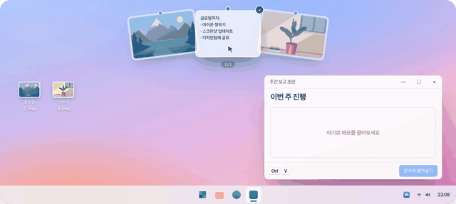
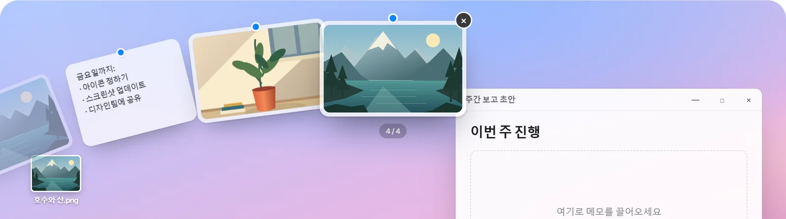
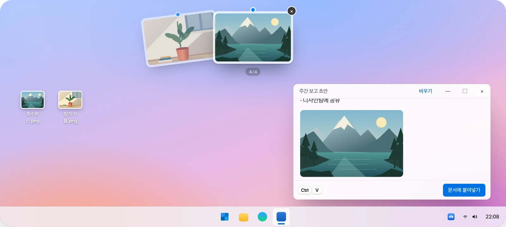
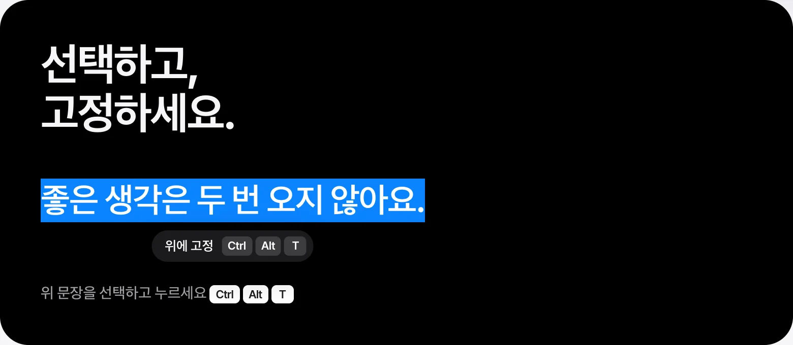
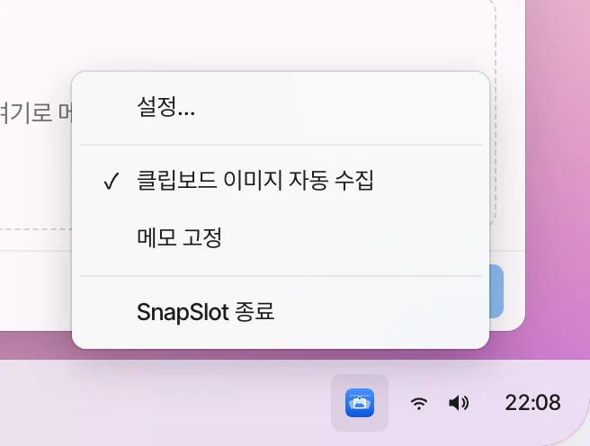
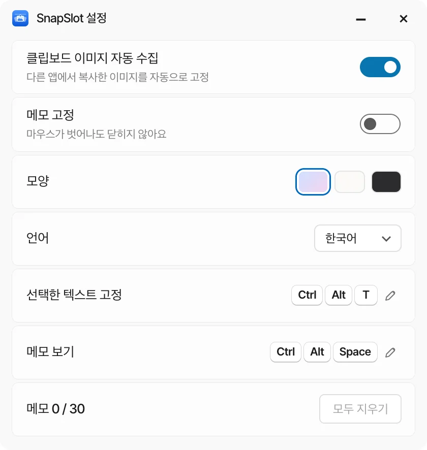
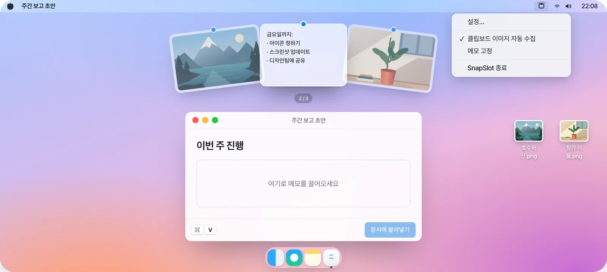
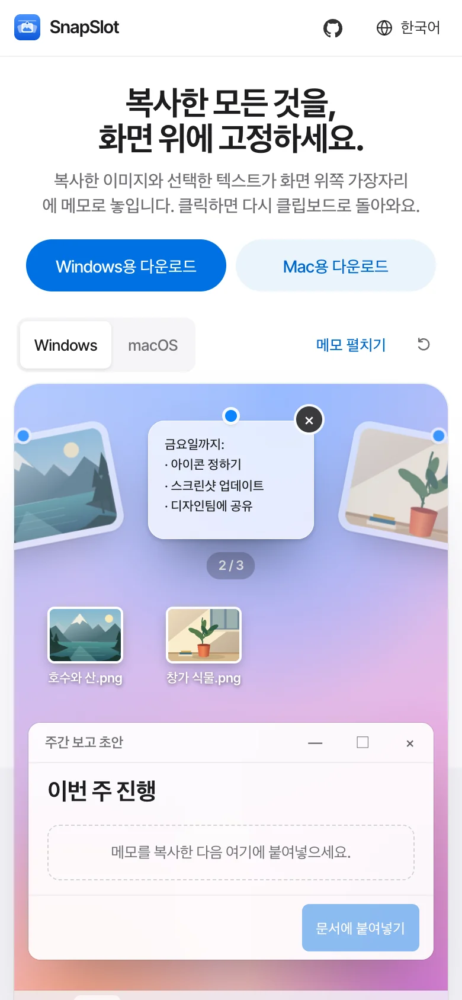

<!-- Generated by scripts/readme-build.py — edit that file, not this one. -->
<p align="center"></p>

<h1 align="center">SnapSlot</h1>

<p align="center"><b>복사한 모든 것을, 화면 위에 고정하세요.</b><br>복사한 이미지와 선택한 텍스트가 화면 위쪽 가장자리에 메모로 놓입니다. 클릭하면 다시 클립보드로 돌아와요.</p>

<p align="center">Windows 10 / 11 · macOS 13+ · 무료 오픈 소스 · 계정 불필요 · 업로드 없음</p>

<p align="center">
  <a href="http://101.200.239.135/ko/"><b>온라인으로 체험</b></a> ·
  <a href="https://github.com/LING-0001/SnapSlot/releases">다운로드</a> ·
  <a href="../../CONTRIBUTING.md">기여하기</a>
</p>

<p align="center"><a href="../../README.md">简体中文</a> · <a href="README.en.md">English</a> · <a href="README.zh-Hant.md">繁體中文</a> · <a href="README.ja.md">日本語</a> · <b>한국어</b> · <a href="README.es.md">Español</a></p>

<p align="center"></p>

## 사용 방법

<table>
<tr><td width="56%"></td><td width="44%"><h3>맨 위에서 잠시 멈추기</h3><p>마우스를 화면 맨 위에 0.5초 두면 메모가 부채꼴로 내려와요. 아래로 옮기면 닫혀요. 휠로 부채를 돌릴 수 있어요.</p></td></tr>
<tr><td width="44%"><h3>끌어다 놓아 쓰기</h3><p>메모를 누른 채 앱이나 폴더로 끌어다 놓으면 PNG / TXT 파일이 돼요.</p></td><td width="56%"></td></tr>
<tr><td width="56%"></td><td width="44%"><h3>텍스트 선택 후 단축키</h3><p>텍스트를 선택하고 <kbd>Ctrl</kbd> <kbd>Alt</kbd> <kbd>T</kbd>(Mac: <kbd>⌃</kbd> <kbd>⌥</kbd> <kbd>T</kbd>)를 누르면 텍스트 메모가 되고, 전체 텍스트도 복사돼요.</p></td></tr>
</table>

## 트레이 메뉴와 설정

<table>
<tr>
<td width="50%"></td>
<td width="50%"></td>
</tr>
</table>

Windows는 트레이 아이콘을 오른쪽 클릭, Mac은 메뉴 막대 아이콘을 클릭: **설정…**, **클립보드 이미지 자동 수집**, **메모 고정**(뒤의 두 개는 켜고 끌 수 있어요. 고정하면 마우스가 벗어나도 닫히지 않아요). 설정에서 모양과 언어 변경, 단축키 확인, 모두 지우기도 할 수 있어요.

## Windows와 macOS

<table>
<tr>
<td width="72%"></td>
<td width="28%"></td>
</tr>
</table>

메모와 조작은 같고, 시스템 기능은 각자 네이티브로 구현했어요. 웹사이트 데모는 휴대폰에서도 동작해요.

## 단축키

| 동작 | Windows | macOS |
| --- | --- | --- |
| 메모 보이기 / 숨기기 | <kbd>Ctrl</kbd> <kbd>Alt</kbd> <kbd>Space</kbd> | <kbd>⌃</kbd> <kbd>⌥</kbd> <kbd>Space</kbd> |
| 선택한 텍스트 고정 | <kbd>Ctrl</kbd> <kbd>Alt</kbd> <kbd>T</kbd> | <kbd>⌃</kbd> <kbd>⌥</kbd> <kbd>T</kbd> |
| 스크린샷 | <kbd>Ctrl</kbd> <kbd>Shift</kbd> <kbd>S</kbd> | <kbd>⌃</kbd> <kbd>⌥</kbd> <kbd>S</kbd> |
| 선택 / 복사 / 삭제 / 숨기기 | <kbd>←</kbd> <kbd>→</kbd> / <kbd>Enter</kbd> / <kbd>Delete</kbd> / <kbd>Esc</kbd> | <kbd>←</kbd> <kbd>→</kbd> / <kbd>Enter</kbd> / <kbd>Delete</kbd> / <kbd>Esc</kbd> |

모든 단축키는 설정에서 다시 지정할 수 있어요.

## 개인정보

임의로 캡처하지 않고, 파일을 읽지 않고, 네트워크를 쓰지 않아요. 다른 앱이 클립보드에 넣은 이미지와, 단축키를 누를 때 선택한 텍스트만 받아요. 최대 30개, 종료하면 모두 사라져요.

## 소스에서 빌드

```bash
# 웹사이트
npm ci --prefix apps/website
npm run dev --prefix apps/website -- --port 3000
```

```powershell
# Windows(.NET 10 SDK, Node.js 22+)
.\scripts\build-windows.ps1
.\artifacts\windows\win-x64\SnapSlot.exe
```

```bash
# macOS(Command Line Tools, Node.js 22+)
./scripts/build-macos.sh
open artifacts/macos/SnapSlot.app
```

Windows에서는 `artifacts/windows/win-x64/` 폴더나 ZIP을 통째로 옮기세요. exe만으로는 실행되지 않아요. Mac 로컬 빌드는 ad-hoc 서명이며 테스트용이에요.

## 저장소 구조

| | |
| --- | --- |
| `apps/website` | 웹사이트(6개 언어), 스킨 파서 |
| `apps/native-ui` | 두 클라이언트가 함께 쓰는 메모·모양 패널 |
| `apps/windows` | Windows 클라이언트(C# / WPF + WebView2) |
| `apps/macos` | macOS 클라이언트(Swift / AppKit + WKWebView) |
| `docs` | 설계 기록, 테스트 항목, README 이미지 |

## 테스트

웹사이트와 공용 UI: 24 / 24 통과. Windows / macOS 검사와 실기기 확인 항목은 [CONTRIBUTING.md](../../CONTRIBUTING.md)와 `docs/native-testing.md`를 보세요.

## 기여하기

Issue와 PR을 환영해요. 커밋 하나에 변경 하나, 플랫폼 하나. 이유·변경 내용·테스트 결과를 적어 주세요. 자세한 내용은 [CONTRIBUTING.md](../../CONTRIBUTING.md)(중국어).

문의와 제안：[GitHub Issues](https://github.com/LING-0001/SnapSlot/issues) · e1347605313@gmail.com

## 라이선스

코드는 MIT 라이선스예요. 이름과 아이콘은 MIT 적용 대상이 아니에요. [BRANDING.md](../../BRANDING.md)를 보세요.
