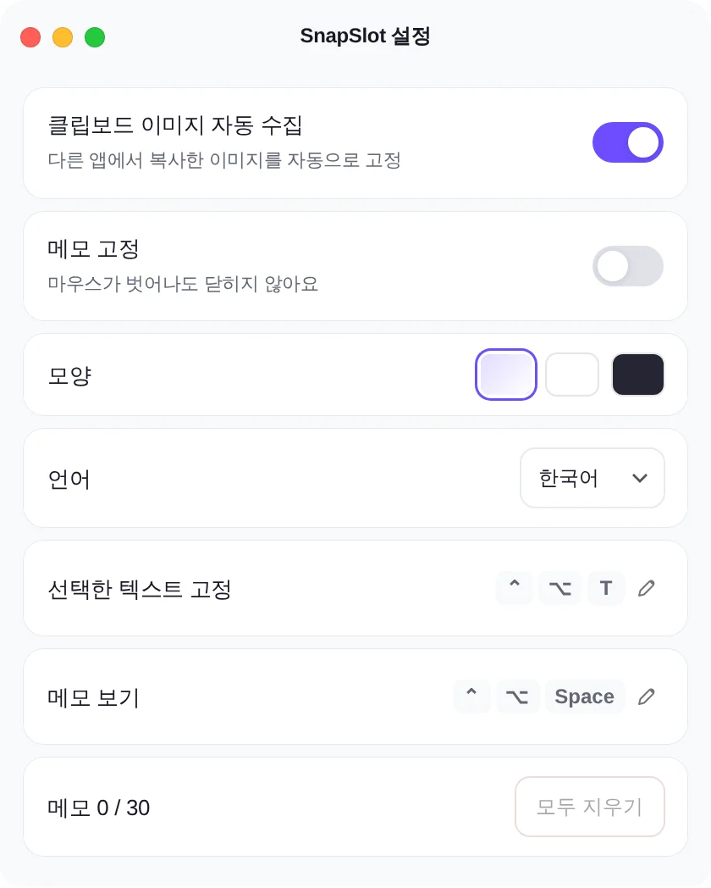

<!-- Generated by scripts/readme-build.py — edit that file, not this one. -->
<p align="center"></p>

<h1 align="center">SnapSlot</h1>

<p align="center"><b>중요한 내용을, 바로 눈앞에.</b><br>스크린샷과 텍스트를 화면 위에 붙여 참고 자료와 아이디어를 가까이 두세요.</p>

<p align="center">
  <a href="https://github.com/LING-0001/SnapSlot/releases/download/v1.1.2/SnapSlot-1.1.2-macOS-universal.dmg"><b>macOS 버전 다운로드</b></a> ·
  <a href="https://github.com/LING-0001/SnapSlot/releases/download/v1.1.2/SnapSlot-1.1.2-windows-x64-setup.exe"><b>Windows 버전 다운로드</b></a> ·
  <a href="https://snapslot.linglinglab.top/ko/">온라인으로 체험</a>
</p>

<p align="center"><a href="../../README.md">简体中文</a> · <a href="README.en.md">English</a> · <a href="README.zh-Hant.md">繁體中文</a> · <a href="README.ja.md">日本語</a> · <b>한국어</b> · <a href="README.es.md">Español</a></p>

<p align="center"><a href="https://raw.githubusercontent.com/LING-0001/SnapSlot/b9d562897b3821d4db235fdfa4ca0a49c70d9ba1/docs/media/ko/demo.mp4"></a></p>
<p align="center"><sub><a href="https://raw.githubusercontent.com/LING-0001/SnapSlot/b9d562897b3821d4db235fdfa4ca0a49c70d9ba1/docs/media/ko/demo.mp4">데모 보기</a> · <a href="https://raw.githubusercontent.com/LING-0001/SnapSlot/b9d562897b3821d4db235fdfa4ca0a49c70d9ba1/docs/media/ko/demo.gif">GIF 보기</a> · <a href="https://github.com/LING-0001/SnapSlot/releases/tag/v1.1.2">v1.1.2</a> · <a href="../../docs/releases/hosting.md">설치 안내</a></sub></p>

## 사용 방법

1. **맨 위에서 잠시 멈추기**<br>
   마우스를 화면 맨 위에 0.5초 두면 메모가 부채꼴로 내려와요. 아래로 옮기면 닫혀요. 휠로 부채를 돌릴 수 있어요.
2. **텍스트 선택 후 단축키**<br>
   복사가 허용된 텍스트를 선택하고 `⌃ ⌥ T`(Windows: `Ctrl + Alt + T`)를 누르면 메모가 됩니다. 원문도 클립보드에 복사됩니다.
3. **끌어다 놓아 쓰기**<br>
   메모를 지원하는 앱이나 폴더에 PNG 또는 TXT로 끌어다 놓을 수 있습니다.

## 메뉴와 설정

macOS 메뉴 막대 아이콘을 클릭하거나 Dock 아이콘을 우클릭하면 설정, 이미지 자동 수집, 메모 고정을 사용할 수 있습니다. Windows에서는 트레이 메뉴를 사용합니다. 설정에서 모양, 언어, 단축키를 변경하거나 현재 메모를 비울 수 있습니다.

<p align="center"></p>

## 단축키

| 동작 | macOS | Windows |
| --- | --- | --- |
| 메모 보이기 / 숨기기 | <kbd>⌃</kbd> <kbd>⌥</kbd> <kbd>Space</kbd> | <kbd>Ctrl</kbd> <kbd>Alt</kbd> <kbd>Space</kbd> |
| 선택한 텍스트 고정 | <kbd>⌃</kbd> <kbd>⌥</kbd> <kbd>T</kbd> | <kbd>Ctrl</kbd> <kbd>Alt</kbd> <kbd>T</kbd> |
| 메모 크게 보기 | <kbd>Space</kbd> | <kbd>Space</kbd> |
| 선택 / 복사 / 삭제 / 숨기기 | <kbd>←</kbd> <kbd>→</kbd> / <kbd>Enter</kbd> / <kbd>Delete</kbd> / <kbd>Esc</kbd> | <kbd>←</kbd> <kbd>→</kbd> / <kbd>Enter</kbd> / <kbd>Delete</kbd> / <kbd>Esc</kbd> |

표는 기본 단축키입니다. 설정에서 단축키를 클릭한 후 새 조합을 누르세요. 시작하거나 설정을 열 때 두 단축키를 함께 확인해 감지된 충돌과 사용 가능한 대체 조합을 먼저 표시합니다. 입력 중에도 다른 앱은 동작하며, Mac 손쉬운 사용 권한은 선택한 텍스트를 수집할 때만 필요합니다. 일부 공유 등록은 감지하지 못할 수 있습니다.

## 개인정보

새로 복사한 이미지를 자동으로 수집합니다. 텍스트는 선택한 뒤 단축키를 눌렀을 때만 수집합니다. 메모는 기기 안에서 처리하며 업로드하지 않습니다. 최대 30개이며, 가득 차면 가장 오래된 메모를 삭제하고 정상 종료 시 현재 메모 세션을 비웁니다.

## 개발 및 기여

<details>
<summary>소스에서 빌드 · 저장소 구조 · 테스트</summary>

### 소스에서 빌드

```bash
# 웹사이트
npm ci --prefix apps/website
npm run dev --prefix apps/website
```

```bash
# macOS(Command Line Tools, Node.js 22+)
./scripts/build-macos.sh
open artifacts/macos/SnapSlot.app
```

```powershell
# Windows(.NET 10 SDK, Node.js 22+)
.\scripts\build-windows.ps1
.\artifacts\windows\win-x64\SnapSlot.exe
```

위의 DMG / Setup 설치 파일을 다운로드해 설치하세요. 소스 빌드 결과물은 개발용입니다. Mac 패키지는 ad-hoc 서명이며 Apple 공증을 받지 않아 첫 실행이 차단될 수 있어요. [릴리스 및 배포 안내](../../docs/releases/hosting.md)를 참고하세요.

### 저장소 구조

| | |
| --- | --- |
| `apps/website` | 6개 언어 웹사이트와 대화형 데모 |
| `apps/native-ui` | 두 클라이언트 공용 부채꼴 메모·메뉴·설정 |
| `apps/windows` | Windows 클라이언트(C# / WPF + WebView2) |
| `apps/macos` | macOS 클라이언트(Swift / AppKit + WKWebView) |
| `docs` | 현재 사양, 테스트 항목, README 이미지 |

### 테스트

빌드, 자동 테스트, 실기기 확인 명령은 [CONTRIBUTING.md](../../CONTRIBUTING.md)와 `docs/native-testing.md`를 보세요.

Issue와 PR을 환영해요. 하나의 요구사항에 맞춰 커밋을 정리하고, 관련 플랫폼과 동작 변경, 실제 검증 결과를 적어 주세요. 자세한 내용은 [CONTRIBUTING.md](../../CONTRIBUTING.md)(중국어).

</details>

## 라이선스

코드는 MIT 라이선스예요. 이름과 아이콘은 MIT 적용 대상이 아니에요. [BRANDING.md](../../BRANDING.md)를 보세요.

[GitHub Issues](https://github.com/LING-0001/SnapSlot/issues) · [기여하기](../../CONTRIBUTING.md) · [e1347605313@gmail.com](mailto:e1347605313@gmail.com)
