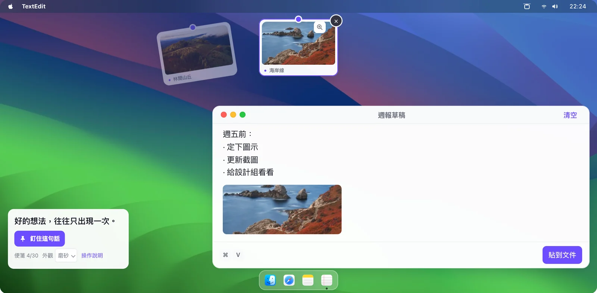
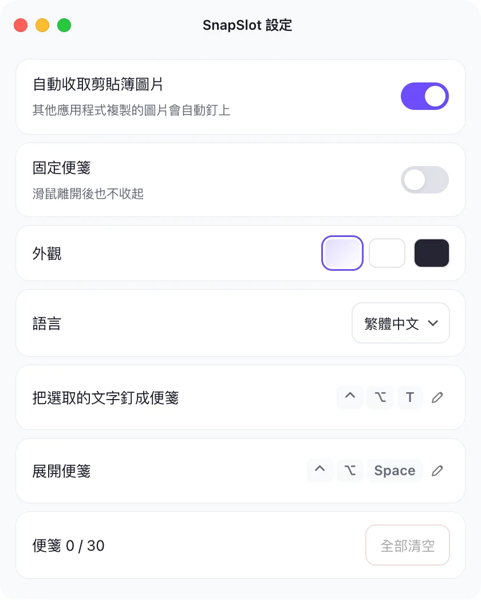

<!-- Generated by scripts/readme-build.py — edit that file, not this one. -->
<p align="center"></p>

<h1 align="center">SnapSlot 快照貼</h1>

<p align="center"><b>把重要的內容，留在眼前。</b><br>把截圖和文字貼在螢幕上方，讓參考資料和臨時想法隨時可見。</p>

<p align="center">
  <a href="https://github.com/LING-0001/SnapSlot/releases/download/v1.1.2/SnapSlot-1.1.2-macOS-universal.dmg"><b>下載 macOS 版</b></a> ·
  <a href="https://github.com/LING-0001/SnapSlot/releases/download/v1.1.2/SnapSlot-1.1.2-windows-x64-setup.exe"><b>下載 Windows 版</b></a> ·
  <a href="https://snapslot.linglinglab.top/zh-Hant/">線上體驗</a>
</p>

<p align="center"><a href="../../README.md">简体中文</a> · <a href="README.en.md">English</a> · <b>繁體中文</b> · <a href="README.ja.md">日本語</a> · <a href="README.ko.md">한국어</a> · <a href="README.es.md">Español</a></p>

<p align="center"><a href="https://raw.githubusercontent.com/LING-0001/SnapSlot/b9d562897b3821d4db235fdfa4ca0a49c70d9ba1/docs/media/zh-Hant/demo.mp4"></a></p>
<p align="center"><sub><a href="https://raw.githubusercontent.com/LING-0001/SnapSlot/b9d562897b3821d4db235fdfa4ca0a49c70d9ba1/docs/media/zh-Hant/demo.mp4">觀看示範</a> · <a href="https://raw.githubusercontent.com/LING-0001/SnapSlot/b9d562897b3821d4db235fdfa4ca0a49c70d9ba1/docs/media/zh-Hant/demo.gif">查看動圖</a> · <a href="https://github.com/LING-0001/SnapSlot/releases/tag/v1.1.2">v1.1.2</a> · <a href="../../docs/releases/hosting.md">安裝說明</a></sub></p>

## 怎麼用

1. **移到上緣，停一下**<br>
   滑鼠在螢幕最上緣停 0.5 秒，便箋會呈扇形落下；往下移開就收起。滾輪可以轉動扇形。
2. **選取文字，按快速鍵**<br>
   選取允許複製的文字，按 `⌃ ⌥ T`（Windows：`Ctrl + Alt + T`），收為文字便箋，原文同時複製到剪貼簿。
3. **拖出去就能用**<br>
   按住便箋拖到支援接收圖片或文字的應用程式，也可以拖到資料夾，以 PNG / TXT 放下。

## 選單與設定

點選 macOS 選單列圖示，或在 Dock 圖示上按右鍵，即可開啟設定、切換自動收取與固定便箋。Windows 使用系統匣右鍵選單。設定中可更換外觀、語言與快速鍵，也可以清空目前便箋。

<p align="center"></p>

## 快速鍵

| 操作 | macOS | Windows |
| --- | --- | --- |
| 展開 / 收起便箋 | <kbd>⌃</kbd> <kbd>⌥</kbd> <kbd>Space</kbd> | <kbd>Ctrl</kbd> <kbd>Alt</kbd> <kbd>Space</kbd> |
| 收取選取的文字 | <kbd>⌃</kbd> <kbd>⌥</kbd> <kbd>T</kbd> | <kbd>Ctrl</kbd> <kbd>Alt</kbd> <kbd>T</kbd> |
| 放大閱讀便箋 | <kbd>Space</kbd> | <kbd>Space</kbd> |
| 挑選 / 複製 / 移除 / 收起 | <kbd>←</kbd> <kbd>→</kbd> / <kbd>Enter</kbd> / <kbd>Delete</kbd> / <kbd>Esc</kbd> | <kbd>←</kbd> <kbd>→</kbd> / <kbd>Enter</kbd> / <kbd>Delete</kbd> / <kbd>Esc</kbd> |

表中為預設快速鍵。在設定中點選組合鍵，再按下新組合即可修改。啟動及開啟設定時會同時檢查兩組快速鍵，提前顯示偵測到的衝突與可用替代組合。錄入不攔截其他應用程式；Mac 僅在收取選取文字時需要輔助使用權限。部分共用註冊的快速鍵可能無法偵測。

## 隱私

自動收取新複製的圖片；文字只在你選取並按下快速鍵時收取。內容在本機處理，不上傳便箋。最多 30 張，額滿移除最早一張，正常結束後清空目前便箋工作階段。

## 開發與貢獻

<details>
<summary>從原始碼建置 · 儲存庫結構 · 測試</summary>

### 從原始碼建置

```bash
# 官網
npm ci --prefix apps/website
npm run dev --prefix apps/website
```

```bash
# macOS（需要 Command Line Tools、Node.js 22+）
./scripts/build-macos.sh
open artifacts/macos/SnapSlot.app
```

```powershell
# Windows（需要 .NET 10 SDK、Node.js 22+）
.\scripts\build-windows.ps1
.\artifacts\windows\win-x64\SnapSlot.exe
```

使用者可直接下載上方 DMG / Setup 安裝套件。原始碼建置產物供開發測試。Mac 套件為 ad-hoc 簽署，尚未經 Apple 公證，系統可能阻止首次啟動。請參閱[發布與部署指南](../../docs/releases/hosting.md)。

### 儲存庫結構

| | |
| --- | --- |
| `apps/website` | 官網與六語言互動示範 |
| `apps/native-ui` | 兩端共用的扇形便箋、選單與設定 |
| `apps/windows` | Windows 用戶端（C# / WPF + WebView2） |
| `apps/macos` | macOS 用戶端（Swift / AppKit + WKWebView） |
| `docs` | 目前規範、測試清單、README 圖片 |

### 測試

建置、自動化測試及實機驗收指令見 [CONTRIBUTING.md](../../CONTRIBUTING.md) 與 `docs/native-testing.md`。

歡迎 Issue 和 PR。圍繞一項需求組織提交，說明涉及平台、行為變更與實際驗證。詳見 [CONTRIBUTING.md](../../CONTRIBUTING.md)（簡體中文）。

</details>

## 授權

程式碼以 MIT 授權開源。名稱與圖示不在 MIT 授權範圍內，見 [BRANDING.md](../../BRANDING.md)。

[GitHub Issues](https://github.com/LING-0001/SnapSlot/issues) · [參與貢獻](../../CONTRIBUTING.md) · [e1347605313@gmail.com](mailto:e1347605313@gmail.com)
