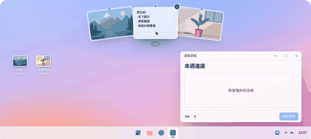
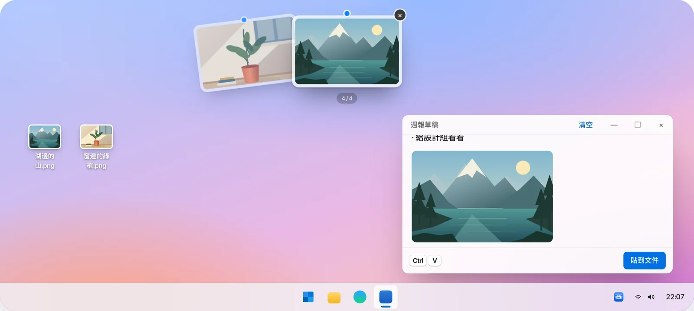
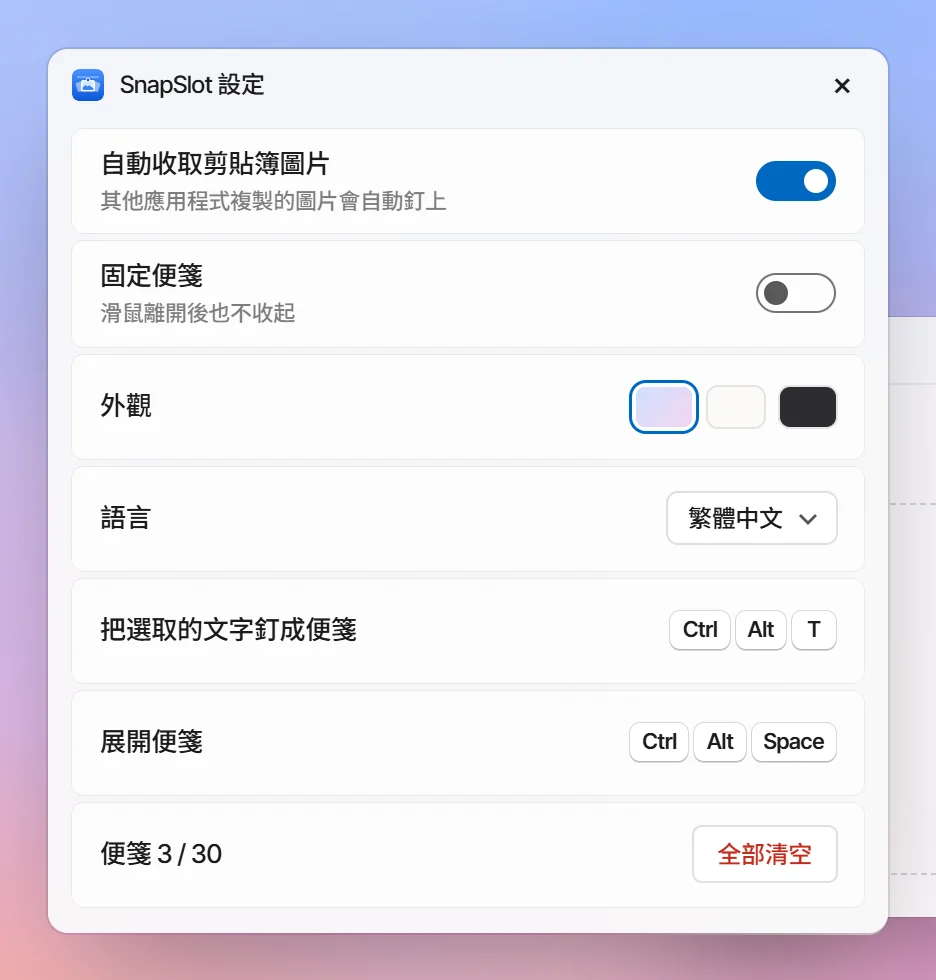

<!-- Generated by scripts/readme-build.py — edit that file, not this one. -->
<p align="center"></p>

<h1 align="center">SnapSlot 快照貼</h1>

<p align="center"><b>複製過的，都釘在螢幕頂端。</b><br>複製的圖片、選取的文字，會變成螢幕上緣的便箋。點一下，就回到剪貼簿。</p>

<p align="center">Windows 10 / 11 · macOS 13+ · 免費開源 · 不需要帳號 · 不上傳</p>

<p align="center">
  <a href="http://101.200.239.135/zh-Hant/"><b>線上體驗</b></a> ·
  <a href="http://101.200.239.135/zh-Hant/#downloads">下載</a> ·
  <a href="https://github.com/LING-0001/SnapSlot/releases">GitHub Releases</a> ·
  <a href="../../CONTRIBUTING.md">參與貢獻</a>
</p>

<p align="center"><a href="../../README.md">简体中文</a> · <a href="README.en.md">English</a> · <b>繁體中文</b> · <a href="README.ja.md">日本語</a> · <a href="README.ko.md">한국어</a> · <a href="README.es.md">Español</a></p>

<p align="center">v1.0.0 · <a href="http://101.200.239.135/downloads/v1.0.0/SnapSlot-1.0.0-macOS-universal.dmg">macOS · DMG · Apple Silicon / Intel</a> · <a href="http://101.200.239.135/downloads/v1.0.0/SnapSlot-1.0.0-windows-x64-setup.exe">Windows x64 · Setup</a></p>

<p align="center"></p>

## 怎麼用

<table>
<tr><td width="56%"></td><td width="44%"><h3>移到上緣，停一下</h3><p>滑鼠在螢幕最上緣停 0.5 秒，便箋會呈扇形落下；往下移開就收起。滾輪可以轉動扇形。</p></td></tr>
<tr><td width="44%"><h3>拖出去就能用</h3><p>按住便箋拖進任何應用程式或資料夾，會以 PNG / TXT 放下。</p></td><td width="56%"></td></tr>
<tr><td width="56%"></td><td width="44%"><h3>選取文字，按快速鍵</h3><p>選取一段文字按 <kbd>Ctrl</kbd> <kbd>Alt</kbd> <kbd>T</kbd>（Mac：<kbd>⌃</kbd> <kbd>⌥</kbd> <kbd>T</kbd>），釘成文字便箋，原文同時複製到剪貼簿。</p></td></tr>
</table>

## 工作列選單與設定

<table>
<tr>
<td width="50%"></td>
<td width="50%"></td>
</tr>
</table>

Windows 在工作列圖示上按右鍵，Mac 點選單列圖示：**設定…**、**自動收取剪貼簿圖片**、**固定便箋**（後兩項可勾選，勾選「固定」後滑鼠離開也不收起）。設定裡還能換外觀、切換語言、查看快速鍵、全部清空。選單底部保留「結束快照貼」入口。

## Windows 與 macOS

<table>
<tr>
<td width="72%"></td>
<td width="28%"></td>
</tr>
</table>

兩端的便箋和操作一致，系統功能各自以原生方式實作。手機上也能體驗官網示範。

## 快速鍵

| 操作 | Windows | macOS |
| --- | --- | --- |
| 展開 / 收起便箋 | <kbd>Ctrl</kbd> <kbd>Alt</kbd> <kbd>Space</kbd> | <kbd>⌃</kbd> <kbd>⌥</kbd> <kbd>Space</kbd> |
| 收取選取的文字 | <kbd>Ctrl</kbd> <kbd>Alt</kbd> <kbd>T</kbd> | <kbd>⌃</kbd> <kbd>⌥</kbd> <kbd>T</kbd> |
| 挑選 / 複製 / 移除 / 收起 | <kbd>←</kbd> <kbd>→</kbd> / <kbd>Enter</kbd> / <kbd>Delete</kbd> / <kbd>Esc</kbd> | <kbd>←</kbd> <kbd>→</kbd> / <kbd>Enter</kbd> / <kbd>Delete</kbd> / <kbd>Esc</kbd> |

表中為預設快速鍵。Mac 和 Windows 設定中均可點選組合鍵修改；遇到佔用時會自動選擇可用組合，並顯示實際生效的快速鍵。

## 隱私

只收其他應用程式寫入剪貼簿的圖片，以及按快速鍵時選取的文字。不會上傳內容；最多 30 張，正常結束後清空。

## 從原始碼建置

```bash
# 官網
npm ci --prefix apps/website
npm run dev --prefix apps/website -- --port 3000
```

```powershell
# Windows（需要 .NET 10 SDK、Node.js 22+）
.\scripts\build-windows.ps1
.\artifacts\windows\win-x64\SnapSlot.exe
```

```bash
# macOS（需要 Command Line Tools、Node.js 22+）
./scripts/build-macos.sh
open artifacts/macos/SnapSlot.app
```

使用者可直接下載上方 DMG / Setup 安裝套件。原始碼建置產物供開發測試。Mac 套件為 ad-hoc 簽署，尚未經 Apple 公證，系統可能阻止首次啟動。請參閱[發布與部署指南](../../docs/releases/hosting.md)。

## 儲存庫結構

| | |
| --- | --- |
| `apps/website` | 官網與六語言互動示範 |
| `apps/native-ui` | 兩端共用的扇形便箋、選單與設定 |
| `apps/windows` | Windows 用戶端（C# / WPF + WebView2） |
| `apps/macos` | macOS 用戶端（Swift / AppKit + WKWebView） |
| `docs` | 目前規範、測試清單、README 圖片 |

## 測試

建置、自動化測試及實機驗收指令見 [CONTRIBUTING.md](../../CONTRIBUTING.md) 與 `docs/native-testing.md`。

## 參與貢獻

歡迎 Issue 和 PR。一個提交只做一件事、一次只改一個平台，寫清楚為什麼改、改了什麼、測試結果。詳見 [CONTRIBUTING.md](../../CONTRIBUTING.md)（簡體中文）。

問題與建議：[GitHub Issues](https://github.com/LING-0001/SnapSlot/issues) · e1347605313@gmail.com

## 授權

程式碼以 MIT 授權開源。名稱與圖示不在 MIT 授權範圍內，見 [BRANDING.md](../../BRANDING.md)。
